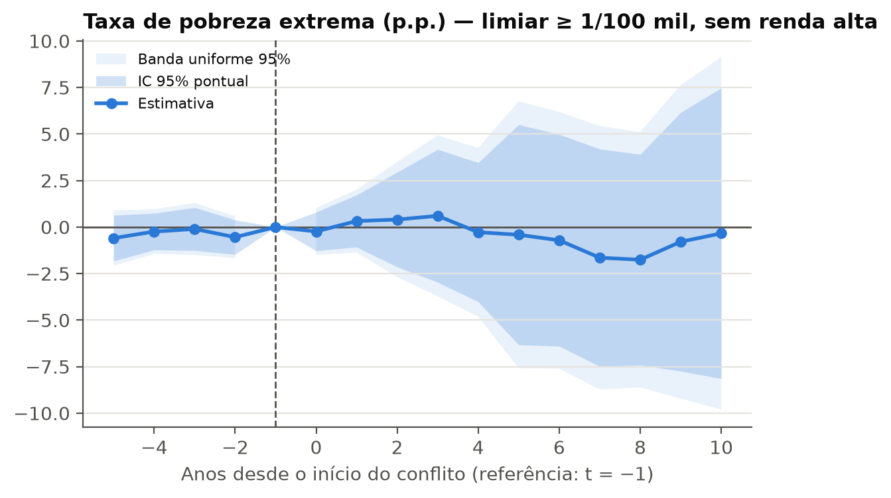
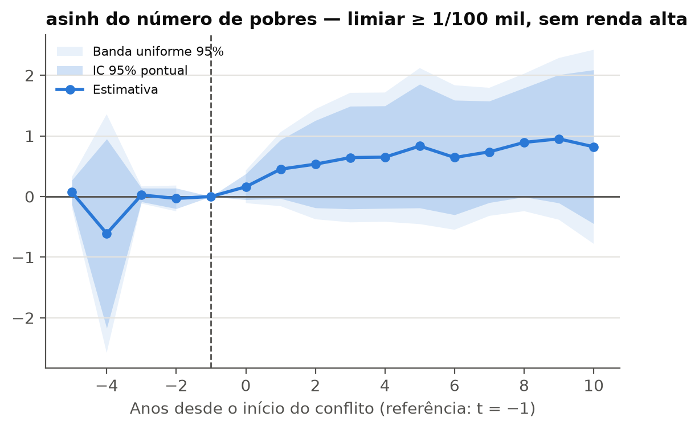
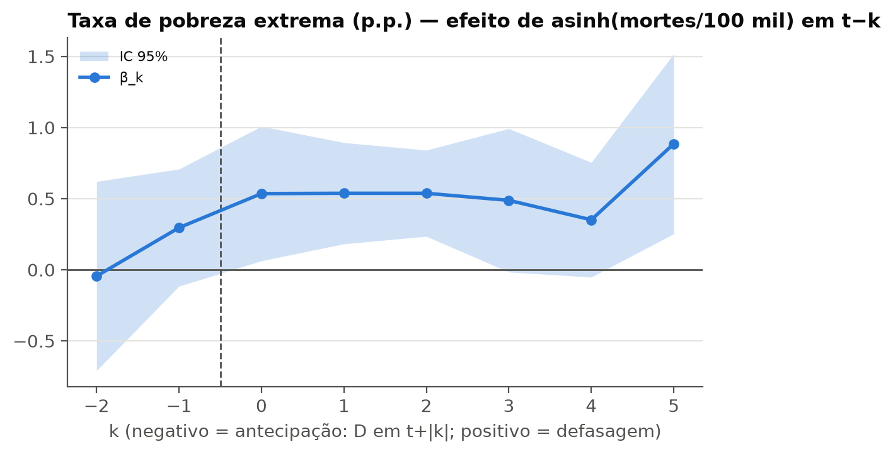
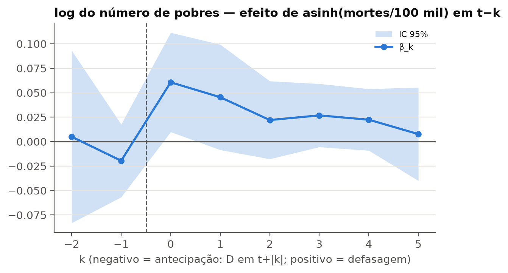
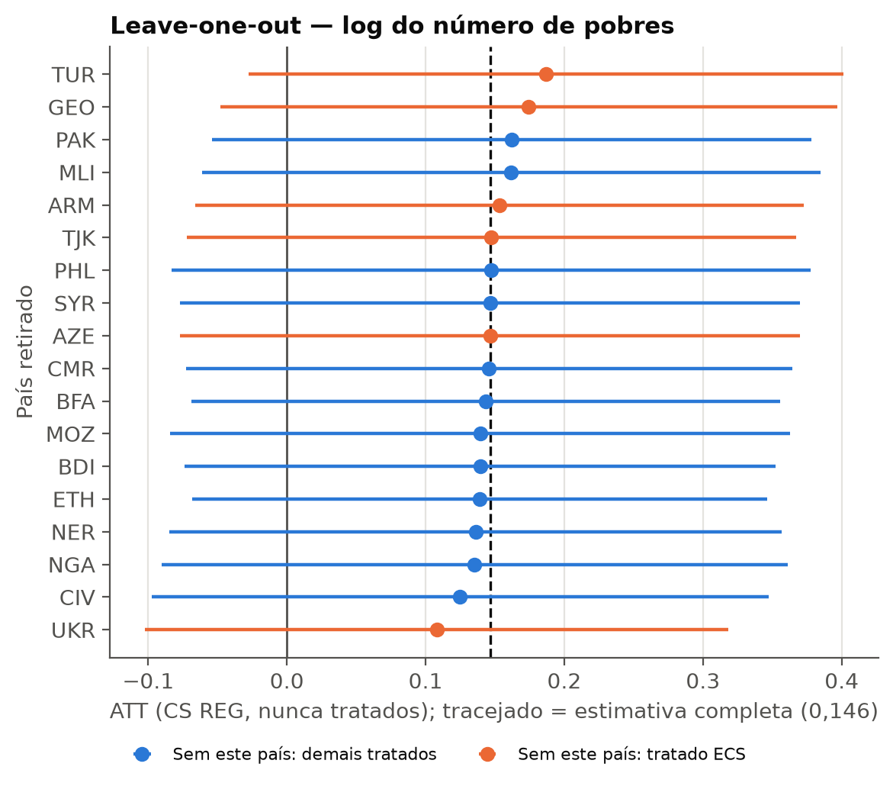
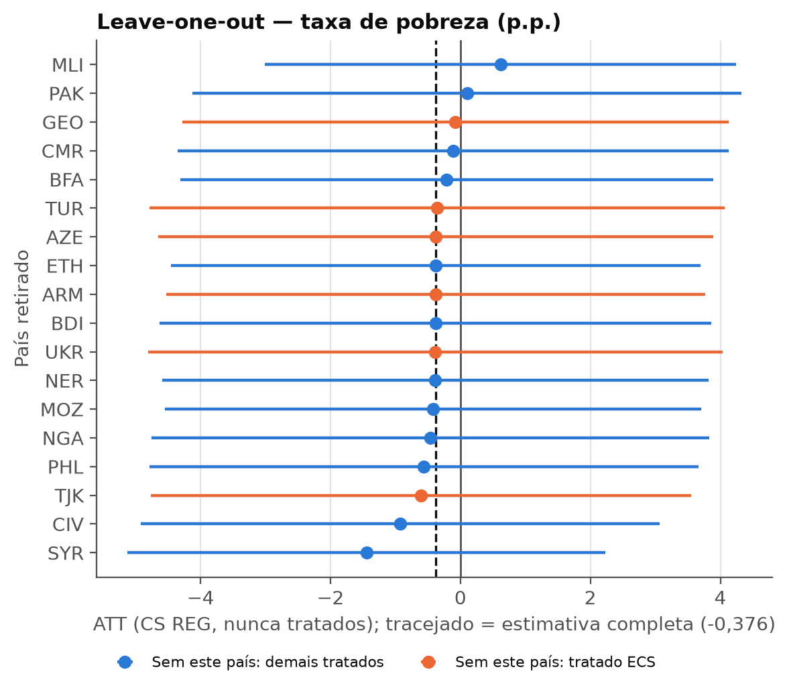
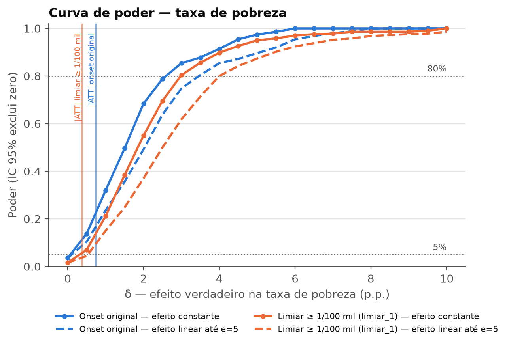
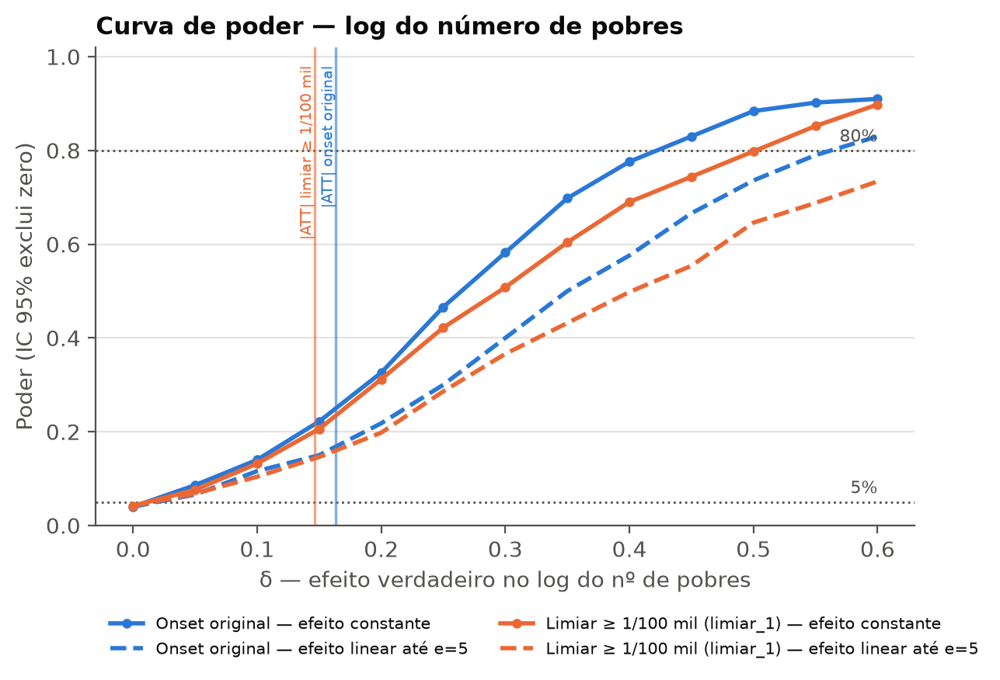

# Exercícios adicionais: intensidade, renda e tratamento contínuo

*Gerado por `src/12_report_exercises.py` a partir de `outputs/tables/ex1_*` e `ex2_*`. Complementa `report/report.md`.*

## Exercício 1 — Tratamento restrito por intensidade (≥ 1 morte/100 mil) e sem países de renda alta

**Por que duas leituras.** Aplicado literalmente aos onsets originais (máximo de mortes nos 3 primeiros anos ≥ 1/100 mil, sem renda alta), o filtro deixa só 7 tratados (BDI BFA CIV CMR SYR TJK UKR). A leitura principal muda o que conta como conflito: um país-ano só é "em conflito" se tiver ≥ 1 morte em combate por 100 mil hab. no território (antes de 1989 usa-se o ACD, porque não há dados de mortes). O onset passa a ser o 1º ano acima do limiar após ≥ 5 anos abaixo dele, com as mesmas regras de elegibilidade (≥ 3 pesquisas antes). Isso dá 18 tratados e traz de volta países antes "sempre tratados" por conflitos crônicos de baixa intensidade que tiveram uma escalada. Países de renda alta (classificação do Banco Mundial em g−1 para tratados e no 1º ano disponível para controles) saem da amostra.

**Coortes por especificação** (`ex1_cohorts.csv`):

| spec | n | coortes |
|---|---|---|
| filtro_literal | 7 | CIV2002 TJK2010 SYR2011 BDI2014 UKR2014 CMR2015 BFA2018 |
| limiar_05 | 23 | VEN1992 PHL2000 CIV2002 GEO2004 TUR2005 NER2007 MLI2008 PAK2008 ETH2009 TJK2010 SYR2011 NGA2013 CMR2014 BDI2014 UKR2014 AZE2015 TUN2015 EGY2015 BFA2019 MOZ2019 KGZ2021 ARM2022 BEN2024 |
| limiar_1 | 18 | PHL2000 CIV2002 PAK2008 GEO2008 TJK2010 SYR2011 MLI2012 TUR2012 NGA2014 CMR2014 UKR2014 BDI2015 NER2015 AZE2016 BFA2019 ETH2020 MOZ2020 ARM2022 |
| limiar_1_com_H | 20 | PHL2000 CIV2002 PAK2008 GEO2008 TJK2010 SYR2011 MLI2012 TUR2012 UKR2014 NGA2014 CMR2014 BDI2015 NER2015 AZE2016 BFA2019 ETH2020 MOZ2020 ISR2021 ARM2022 RUS2024 |
| limiar_1_ctrl_baixa | 18 | PHL2000 CIV2002 PAK2008 GEO2008 TJK2010 SYR2011 MLI2012 TUR2012 NGA2014 CMR2014 UKR2014 BDI2015 NER2015 AZE2016 BFA2019 ETH2020 MOZ2020 ARM2022 |

**Especificação principal (limiar ≥ 1/100 mil, sem renda alta), todos os estimadores:**

| outcome | estimator | estimate | se | ci_low | ci_high | p_value | n_treated | pretrend_p |
|---|---|---|---|---|---|---|---|---|
| pov_rate | CS (REG, nunca tratados) | -0,376 | 2,009 | -4,314 | 3,562 | 0,852 | 18 | 0,598 |
| pov_rate | CS (REG, ainda não tratados) | -0,022 | 1,902 | -3,750 | 3,707 | 0,991 | 18 | 0,260 |
| pov_rate | CS (sem covariáveis, nunca tratados) | -0,777 | 1,833 | -4,369 | 2,815 | 0,672 | 18 | 0,217 |
| pov_rate | TWFE | -5,964 | 3,685 | -13,288 | 1,360 | 0,109 | 18 | — |
| pov_rate | Sun-Abraham (IW) | -0,780 | 0,971 | -2,709 | 1,149 | 0,424 | 18 | — |
| ln_n_poor | CS (REG, nunca tratados) | 0,146 | 0,114 | -0,077 | 0,370 | 0,199 | 16 | 0,650 |
| ln_n_poor | CS (REG, ainda não tratados) | 0,145 | 0,113 | -0,078 | 0,367 | 0,202 | 16 | 0,774 |
| ln_n_poor | CS (sem covariáveis, nunca tratados) | 0,206 | 0,102 | 0,007 | 0,406 | 0,043 | 16 | 0,312 |
| ln_n_poor | TWFE | 0,535 | 0,334 | -0,129 | 1,198 | 0,113 | 18 | — |
| ln_n_poor | Sun-Abraham (IW) | 0,498 | 0,059 | 0,381 | 0,615 | 0,000 | 18 | — |
| asinh_n_poor | CS (REG, nunca tratados) | 0,641 | 0,403 | -0,149 | 1,430 | 0,112 | 18 | 0,532 |
| asinh_n_poor | CS (REG, ainda não tratados) | 0,652 | 0,400 | -0,133 | 1,437 | 0,104 | 18 | 0,478 |
| asinh_n_poor | CS (sem covariáveis, nunca tratados) | 0,597 | 0,394 | -0,175 | 1,369 | 0,130 | 18 | 0,807 |
| asinh_n_poor | TWFE | 0,398 | 0,562 | -0,719 | 1,516 | 0,481 | 18 | — |
| asinh_n_poor | Sun-Abraham (IW) | 0,583 | 0,118 | 0,348 | 0,817 | 0,000 | 18 | — |
| d_ln_n_poor | CS (REG, nunca tratados) | 0,079 | 0,080 | -0,077 | 0,235 | 0,323 | 16 | 0,660 |
| d_ln_n_poor | CS (REG, ainda não tratados) | 0,084 | 0,086 | -0,084 | 0,252 | 0,328 | 16 | 0,665 |
| d_ln_n_poor | CS (sem covariáveis, nunca tratados) | 0,082 | 0,093 | -0,100 | 0,263 | 0,379 | 16 | 0,368 |
| d_ln_n_poor | TWFE | 0,026 | 0,051 | -0,076 | 0,129 | 0,609 | 18 | — |
| d_ln_n_poor | Sun-Abraham (IW) | 0,065 | 0,058 | -0,050 | 0,181 | 0,265 | 18 | — |

**Variantes (CS REG, nunca tratados):**

| descricao | outcome | estimate | se | ci_low | ci_high | p_value | n_treated | pretrend_p |
|---|---|---|---|---|---|---|---|---|
| Limiar ≥ 1/100 mil, controles = nunca acima do limiar | pov_rate | 0,087 | 2,018 | -3,868 | 4,042 | 0,966 | 18 | 0,574 |
| Limiar ≥ 1/100 mil, controles = nunca acima do limiar | ln_n_poor | 0,126 | 0,094 | -0,058 | 0,311 | 0,180 | 16 | 0,733 |
| Limiar ≥ 1/100 mil, controles = nunca acima do limiar | asinh_n_poor | 0,524 | 0,381 | -0,222 | 1,270 | 0,169 | 18 | 0,387 |
| Limiar ≥ 1/100 mil, controles = nunca acima do limiar | d_ln_n_poor | 0,076 | 0,086 | -0,092 | 0,245 | 0,374 | 16 | 0,670 |
| Limiar ≥ 1/100 mil, com renda alta | pov_rate | -0,330 | 1,741 | -3,742 | 3,082 | 0,850 | 20 | 0,433 |
| Limiar ≥ 1/100 mil, com renda alta | ln_n_poor | 0,142 | 0,133 | -0,119 | 0,402 | 0,286 | 18 | 0,864 |
| Limiar ≥ 1/100 mil, com renda alta | asinh_n_poor | 0,479 | 0,395 | -0,296 | 1,254 | 0,225 | 20 | 0,234 |
| Limiar ≥ 1/100 mil, com renda alta | d_ln_n_poor | 0,091 | 0,092 | -0,088 | 0,271 | 0,319 | 18 | 0,319 |
| Limiar ≥ 0,5/100 mil, sem renda alta | pov_rate | 0,248 | 1,641 | -2,968 | 3,464 | 0,880 | 22 | 0,011 |
| Limiar ≥ 0,5/100 mil, sem renda alta | ln_n_poor | 0,135 | 0,116 | -0,093 | 0,362 | 0,246 | 19 | 0,097 |
| Limiar ≥ 0,5/100 mil, sem renda alta | asinh_n_poor | 0,476 | 0,348 | -0,206 | 1,158 | 0,171 | 22 | 0,558 |
| Limiar ≥ 0,5/100 mil, sem renda alta | d_ln_n_poor | 0,068 | 0,075 | -0,079 | 0,215 | 0,365 | 19 | 0,083 |
| Onsets originais com ≥ 1/100 mil nos 3 primeiros anos, sem renda alta | pov_rate | 2,683 | 3,102 | -3,397 | 8,763 | 0,387 | 7 | 0,287 |
| Onsets originais com ≥ 1/100 mil nos 3 primeiros anos, sem renda alta | ln_n_poor | 0,311 | 0,124 | 0,067 | 0,555 | 0,012 | 6 | 0,088 |
| Onsets originais com ≥ 1/100 mil nos 3 primeiros anos, sem renda alta | asinh_n_poor | 1,072 | 0,837 | -0,569 | 2,713 | 0,200 | 7 | 0,081 |
| Onsets originais com ≥ 1/100 mil nos 3 primeiros anos, sem renda alta | d_ln_n_poor | 0,212 | 0,175 | -0,131 | 0,556 | 0,225 | 6 | 0,107 |

**Leitura.**

- Taxa de pobreza: ATT = -0,38 p.p. (IC [-4,31; 3,56]; não significativo), contra -0,73 na definição original. Pré-tendências não rejeitadas (p = 0,598).
- Número de pobres: log = 0,15 (IC [-0,08; 0,37]); asinh = 0,64 (IC [-0,15; 1,43]). As estimativas pontuais são maiores que na definição original e positivas em todas as variantes, mas o IC da especificação principal inclui zero.
- Sun–Abraham dá EP muito menores (ex.: log nº de pobres 0,50, EP 0,06). Com coortes de um único país, cada interação coorte × período é identificada por um só cluster e o EP agrupado não é confiável. Esses EPs não devem ser usados para inferência; o bootstrap multiplicador do CS é a referência.
- Sensibilidade Rambachan–Roth (aprox., média e ∈ [0,5]), `ex1_honestdid.csv`:

| outcome | M | theta | ci_low | ci_high |
|---|---|---|---|---|
| pov_rate | 0 | 0,066 | -2,472 | 2,673 |
| pov_rate | 1 | 0,066 | -6,739 | 6,102 |
| pov_rate | SD(0): tendência linear extrapolada | 0,905 | -1,915 | 3,688 |
| ln_n_poor | 0 | 0,141 | -0,044 | 0,322 |
| ln_n_poor | 1 | 0,141 | -0,491 | 0,865 |
| ln_n_poor | SD(0): tendência linear extrapolada | 0,179 | -0,130 | 0,482 |
| asinh_n_poor | 0 | 0,545 | -0,004 | 1,086 |
| asinh_n_poor | 1 | 0,545 | -5,216 | 7,157 |
| asinh_n_poor | SD(0): tendência linear extrapolada | 0,184 | -0,398 | 0,761 |

## Exercício 2 — Tratamento não absorvente com intensidade contínua

Tratamento D_it = mortes em combate (state-based) no território por 100 mil hab., ano a ano, entrando e saindo livremente. Uma escalada de 1 para 50/100 mil é variação de tratamento. Amostra: todos os países soberanos (inclusive os excluídos do desenho de onset, como os "sempre tratados"), 1990–2024; variante sem renda alta. Como a distribuição de D é muito assimétrica (Síria ≈ 186/100 mil), a dose é usada em duas escalas: linear e **asinh(D)** (≈ log para D grande).

**Estimadores** (`src/11_exercise_continuous.py`):

1. *TWFE nível*: y = α_i + λ_t + βD. Sujeito aos vieses de TWFE com efeitos heterogêneos (de Chaisemartin & D'Haultfœuille, 2020); só como referência.
2. *Defasagens distribuídas*: D em t+2…t−5. As antecipações (t+1, t+2) testam causalidade reversa; o cumulativo soma L0…L5.
3. *Primeiras diferenças*: Δy = λ_t + βΔD (+ ΔD_{t+1}).
4. **WAOSS (principal)**: switchers (|ΔD| > ε) contra quasi-stayers (|ΔD| ≤ ε) com o mesmo nível de partida (faixas de D_{t−1}: 0; ≤ 0,1; ≤ 1; ≤ 10; > 10) e efeitos de ano; θ = Σ sinal(ΔD)(ΔY − ΔŶ0)/Σ|ΔD|, ou seja, o efeito médio por unidade de dose ponderado pela magnitude da mudança. Também é estimado separadamente para escaladas e desescaladas. Placebo: a mesma conta com ΔY do período anterior. EP por bootstrap de países (300 réplicas). **Implementação própria**, inspirada em de Chaisemartin, D'Haultfœuille, Pasquier, Sow & Vazquez-Bare (2024). Validada em simulação (`tests/test_did_tools.py`: θ̂ = β com seleção em nível), mas não é o pacote oficial (`did_multiplegt_dyn` / `did_had`).

### Dose = asinh(mortes/100 mil)

| amostra | outcome | modelo | termo | estimate | se | p_value |
|---|---|---|---|---|---|---|
| todos | pov_rate | TWFE nível | asinh_brd_pc | 1,2935 | 0,5816 | 0,027 |
| todos | pov_rate | Defasagens distribuídas | cumulativo L0..L5 | 3,3349 | 1,0545 | 0,002 |
| todos | pov_rate | Defasagens distribuídas | Wald antecipações (F1,F2) = 0 | 2,6935 | — | 0,260 |
| todos | pov_rate | Primeiras diferenças | ΔD_t | 0,4401 | 0,1098 | 0,000 |
| todos | pov_rate | Primeiras diferenças | ΔD_t+1 (antecipação) | -0,0212 | 0,1015 | 0,835 |
| todos | ln_n_poor | TWFE nível | asinh_brd_pc | 0,0890 | 0,0613 | 0,148 |
| todos | ln_n_poor | Defasagens distribuídas | cumulativo L0..L5 | 0,1852 | 0,1044 | 0,078 |
| todos | ln_n_poor | Defasagens distribuídas | Wald antecipações (F1,F2) = 0 | 1,1007 | — | 0,577 |
| todos | ln_n_poor | Primeiras diferenças | ΔD_t | 0,0530 | 0,0160 | 0,001 |
| todos | ln_n_poor | Primeiras diferenças | ΔD_t+1 (antecipação) | -0,0041 | 0,0078 | 0,597 |
| todos | asinh_n_poor | TWFE nível | asinh_brd_pc | 0,2024 | 0,0953 | 0,035 |
| todos | asinh_n_poor | Defasagens distribuídas | cumulativo L0..L5 | 0,3669 | 0,1754 | 0,038 |
| todos | asinh_n_poor | Defasagens distribuídas | Wald antecipações (F1,F2) = 0 | 0,1490 | — | 0,928 |
| todos | asinh_n_poor | Primeiras diferenças | ΔD_t | 0,0594 | 0,0176 | 0,001 |
| todos | asinh_n_poor | Primeiras diferenças | ΔD_t+1 (antecipação) | 0,0214 | 0,0203 | 0,295 |
| sem renda alta | pov_rate | TWFE nível | asinh_brd_pc | 1,2122 | 0,6401 | 0,060 |
| sem renda alta | pov_rate | Defasagens distribuídas | cumulativo L0..L5 | 3,1357 | 1,1202 | 0,006 |
| sem renda alta | pov_rate | Defasagens distribuídas | Wald antecipações (F1,F2) = 0 | 2,6247 | — | 0,269 |
| sem renda alta | pov_rate | Primeiras diferenças | ΔD_t | 0,4580 | 0,1149 | 0,000 |
| sem renda alta | pov_rate | Primeiras diferenças | ΔD_t+1 (antecipação) | -0,0271 | 0,1071 | 0,800 |
| sem renda alta | ln_n_poor | TWFE nível | asinh_brd_pc | 0,0832 | 0,0666 | 0,213 |
| sem renda alta | ln_n_poor | Defasagens distribuídas | cumulativo L0..L5 | 0,1742 | 0,1133 | 0,126 |
| sem renda alta | ln_n_poor | Defasagens distribuídas | Wald antecipações (F1,F2) = 0 | 0,6878 | — | 0,709 |
| sem renda alta | ln_n_poor | Primeiras diferenças | ΔD_t | 0,0517 | 0,0171 | 0,003 |
| sem renda alta | ln_n_poor | Primeiras diferenças | ΔD_t+1 (antecipação) | 0,0007 | 0,0071 | 0,917 |
| sem renda alta | asinh_n_poor | TWFE nível | asinh_brd_pc | 0,1988 | 0,1022 | 0,053 |
| sem renda alta | asinh_n_poor | Defasagens distribuídas | cumulativo L0..L5 | 0,3528 | 0,1836 | 0,057 |
| sem renda alta | asinh_n_poor | Defasagens distribuídas | Wald antecipações (F1,F2) = 0 | 0,2018 | — | 0,904 |
| sem renda alta | asinh_n_poor | Primeiras diferenças | ΔD_t | 0,0567 | 0,0184 | 0,002 |
| sem renda alta | asinh_n_poor | Primeiras diferenças | ΔD_t+1 (antecipação) | 0,0285 | 0,0204 | 0,164 |

**WAOSS (ε = 0,1):**

| amostra | outcome | tipo | θ | EP | p | θ escalada | EP esc. | p esc. | θ desescalada | EP desesc. | switchers | ↑ | ↓ |
|---|---|---|---|---|---|---|---|---|---|---|---|---|---|
| todos | pov_rate | efeito | 0,4448 | 0,1153 | 0,000 | 0,5021 | 0,2055 | 0,015 | 0,3905 | 0,2401 | 938 | 463 | 475 |
| todos | pov_rate | placebo | 0,1442 | 0,1856 | 0,437 | 0,3793 | 0,2116 | 0,073 | -1,2127 | 0,9367 | 219 | 165 | 54 |
| todos | ln_n_poor | efeito | 0,0378 | 0,0154 | 0,014 | 0,0604 | 0,0217 | 0,005 | 0,0164 | 0,0320 | 920 | 454 | 466 |
| todos | ln_n_poor | placebo | 0,0249 | 0,0193 | 0,196 | 0,0546 | 0,0189 | 0,004 | -0,1402 | 0,1153 | 212 | 160 | 52 |
| todos | asinh_n_poor | efeito | 0,0279 | 0,0204 | 0,172 | 0,0523 | 0,0414 | 0,207 | 0,0047 | 0,0433 | 938 | 463 | 475 |
| todos | asinh_n_poor | placebo | 0,1212 | 0,0844 | 0,151 | 0,1081 | 0,0754 | 0,151 | 0,1968 | 0,4058 | 219 | 165 | 54 |
| sem renda alta | pov_rate | efeito | 0,4669 | 0,1228 | 0,000 | 0,5430 | 0,2349 | 0,021 | 0,3950 | 0,2381 | 907 | 445 | 462 |
| sem renda alta | pov_rate | placebo | 0,2156 | 0,1807 | 0,233 | 0,4542 | 0,2234 | 0,042 | -1,2559 | 1,0095 | 215 | 162 | 53 |
| sem renda alta | ln_n_poor | efeito | 0,0341 | 0,0155 | 0,028 | 0,0631 | 0,0210 | 0,003 | 0,0067 | 0,0323 | 889 | 436 | 453 |
| sem renda alta | ln_n_poor | placebo | 0,0302 | 0,0184 | 0,101 | 0,0603 | 0,0196 | 0,002 | -0,1489 | 0,1307 | 208 | 157 | 51 |
| sem renda alta | asinh_n_poor | efeito | 0,0208 | 0,0205 | 0,312 | 0,0586 | 0,0402 | 0,145 | -0,0150 | 0,0466 | 907 | 445 | 462 |
| sem renda alta | asinh_n_poor | placebo | 0,1315 | 0,0849 | 0,121 | 0,1189 | 0,0722 | 0,099 | 0,2093 | 0,4357 | 215 | 162 | 53 |

### Dose = mortes/100 mil (linear)

| amostra | outcome | modelo | termo | estimate | se | p_value |
|---|---|---|---|---|---|---|
| todos | pov_rate | TWFE nível | brd_pc | 0,0327 | 0,0100 | 0,001 |
| todos | pov_rate | Defasagens distribuídas | cumulativo L0..L5 | 0,0776 | 0,0324 | 0,018 |
| todos | pov_rate | Defasagens distribuídas | Wald antecipações (F1,F2) = 0 | 13,2016 | — | 0,001 |
| todos | pov_rate | Primeiras diferenças | ΔD_t | 0,0170 | 0,0030 | 0,000 |
| todos | pov_rate | Primeiras diferenças | ΔD_t+1 (antecipação) | 0,0032 | 0,0027 | 0,233 |
| todos | ln_n_poor | TWFE nível | brd_pc | 0,0028 | 0,0022 | 0,192 |
| todos | ln_n_poor | Defasagens distribuídas | cumulativo L0..L5 | 0,0081 | 0,0055 | 0,137 |
| todos | ln_n_poor | Defasagens distribuídas | Wald antecipações (F1,F2) = 0 | 1,1636 | — | 0,559 |
| todos | ln_n_poor | Primeiras diferenças | ΔD_t | 0,0014 | 0,0008 | 0,070 |
| todos | ln_n_poor | Primeiras diferenças | ΔD_t+1 (antecipação) | 0,0004 | 0,0003 | 0,262 |
| todos | asinh_n_poor | TWFE nível | brd_pc | 0,0043 | 0,0029 | 0,134 |
| todos | asinh_n_poor | Defasagens distribuídas | cumulativo L0..L5 | 0,0132 | 0,0085 | 0,122 |
| todos | asinh_n_poor | Defasagens distribuídas | Wald antecipações (F1,F2) = 0 | 1,4571 | — | 0,483 |
| todos | asinh_n_poor | Primeiras diferenças | ΔD_t | 0,0015 | 0,0008 | 0,058 |
| todos | asinh_n_poor | Primeiras diferenças | ΔD_t+1 (antecipação) | 0,0004 | 0,0004 | 0,251 |
| sem renda alta | pov_rate | TWFE nível | brd_pc | 0,0317 | 0,0122 | 0,010 |
| sem renda alta | pov_rate | Defasagens distribuídas | cumulativo L0..L5 | 0,0732 | 0,0369 | 0,049 |
| sem renda alta | pov_rate | Defasagens distribuídas | Wald antecipações (F1,F2) = 0 | 15,0946 | — | 0,001 |
| sem renda alta | pov_rate | Primeiras diferenças | ΔD_t | 0,0175 | 0,0030 | 0,000 |
| sem renda alta | pov_rate | Primeiras diferenças | ΔD_t+1 (antecipação) | 0,0034 | 0,0027 | 0,217 |
| sem renda alta | ln_n_poor | TWFE nível | brd_pc | 0,0028 | 0,0023 | 0,236 |
| sem renda alta | ln_n_poor | Defasagens distribuídas | cumulativo L0..L5 | 0,0080 | 0,0058 | 0,173 |
| sem renda alta | ln_n_poor | Defasagens distribuídas | Wald antecipações (F1,F2) = 0 | 1,3902 | — | 0,499 |
| sem renda alta | ln_n_poor | Primeiras diferenças | ΔD_t | 0,0014 | 0,0008 | 0,077 |
| sem renda alta | ln_n_poor | Primeiras diferenças | ΔD_t+1 (antecipação) | 0,0005 | 0,0004 | 0,150 |
| sem renda alta | asinh_n_poor | TWFE nível | brd_pc | 0,0043 | 0,0031 | 0,173 |
| sem renda alta | asinh_n_poor | Defasagens distribuídas | cumulativo L0..L5 | 0,0130 | 0,0090 | 0,150 |
| sem renda alta | asinh_n_poor | Defasagens distribuídas | Wald antecipações (F1,F2) = 0 | 1,7321 | — | 0,421 |
| sem renda alta | asinh_n_poor | Primeiras diferenças | ΔD_t | 0,0015 | 0,0008 | 0,062 |
| sem renda alta | asinh_n_poor | Primeiras diferenças | ΔD_t+1 (antecipação) | 0,0005 | 0,0004 | 0,140 |

**WAOSS (ε = 0,1):**

| amostra | outcome | tipo | θ | EP | p | θ escalada | EP esc. | p esc. | θ desescalada | EP desesc. | switchers | ↑ | ↓ |
|---|---|---|---|---|---|---|---|---|---|---|---|---|---|
| todos | pov_rate | efeito | 0,0195 | 0,0159 | 0,219 | 0,0448 | 0,0316 | 0,156 | -0,0067 | 0,0528 | 981 | 481 | 500 |
| todos | pov_rate | placebo | 0,0182 | 0,0264 | 0,492 | 0,0197 | 0,0253 | 0,436 | -0,0966 | 0,8338 | 194 | 153 | 41 |
| todos | ln_n_poor | efeito | 0,0035 | 0,0014 | 0,013 | 0,0043 | 0,0020 | 0,036 | 0,0026 | 0,0023 | 963 | 472 | 491 |
| todos | ln_n_poor | placebo | 0,0037 | 0,0037 | 0,314 | 0,0039 | 0,0041 | 0,353 | -0,0051 | 0,0771 | 187 | 148 | 39 |
| todos | asinh_n_poor | efeito | 0,0030 | 0,0018 | 0,107 | 0,0032 | 0,0035 | 0,356 | 0,0027 | 0,0037 | 981 | 481 | 500 |
| todos | asinh_n_poor | placebo | 0,0158 | 0,0168 | 0,347 | 0,0101 | 0,0116 | 0,384 | 0,4340 | 0,6739 | 194 | 153 | 41 |
| sem renda alta | pov_rate | efeito | 0,0236 | 0,0161 | 0,144 | 0,0483 | 0,0357 | 0,177 | -0,0014 | 0,0515 | 949 | 463 | 486 |
| sem renda alta | pov_rate | placebo | 0,0250 | 0,0258 | 0,333 | 0,0275 | 0,0271 | 0,309 | -0,1657 | 0,9009 | 191 | 150 | 41 |
| sem renda alta | ln_n_poor | efeito | 0,0030 | 0,0015 | 0,038 | 0,0051 | 0,0022 | 0,018 | 0,0009 | 0,0026 | 931 | 454 | 477 |
| sem renda alta | ln_n_poor | placebo | 0,0041 | 0,0033 | 0,202 | 0,0043 | 0,0035 | 0,209 | -0,0095 | 0,0756 | 184 | 145 | 39 |
| sem renda alta | asinh_n_poor | efeito | 0,0020 | 0,0019 | 0,299 | 0,0047 | 0,0035 | 0,176 | -0,0008 | 0,0042 | 949 | 463 | 486 |
| sem renda alta | asinh_n_poor | placebo | 0,0166 | 0,0150 | 0,270 | 0,0112 | 0,0113 | 0,324 | 0,4167 | 0,5815 | 191 | 150 | 41 |

**Sensibilidade a ε** (`ex2_continuous_waoss.csv`, efeito, amostra completa):

| dose | outcome | eps | all | se_all | p_all | n_sw |
|---|---|---|---|---|---|---|
| brd_pc | pov_rate | 0,000 | 0,0287 | 0,0103 | 0,005 | 1572 |
| brd_pc | pov_rate | 0,100 | 0,0195 | 0,0159 | 0,219 | 981 |
| brd_pc | pov_rate | 0,500 | 0,0223 | 0,0105 | 0,033 | 660 |
| brd_pc | ln_n_poor | 0,000 | 0,0026 | 0,0013 | 0,045 | 1529 |
| brd_pc | ln_n_poor | 0,100 | 0,0035 | 0,0014 | 0,013 | 963 |
| brd_pc | ln_n_poor | 0,500 | 0,0036 | 0,0014 | 0,009 | 653 |
| brd_pc | asinh_n_poor | 0,000 | 0,0030 | 0,0020 | 0,132 | 1572 |
| brd_pc | asinh_n_poor | 0,100 | 0,0030 | 0,0018 | 0,107 | 981 |
| brd_pc | asinh_n_poor | 0,500 | 0,0038 | 0,0014 | 0,008 | 660 |
| asinh_brd_pc | pov_rate | 0,000 | 0,3247 | 0,1105 | 0,003 | 1572 |
| asinh_brd_pc | pov_rate | 0,100 | 0,4448 | 0,1153 | 0,000 | 938 |
| asinh_brd_pc | pov_rate | 0,500 | 0,4367 | 0,1090 | 0,000 | 486 |
| asinh_brd_pc | ln_n_poor | 0,000 | 0,0296 | 0,0139 | 0,033 | 1529 |
| asinh_brd_pc | ln_n_poor | 0,100 | 0,0378 | 0,0154 | 0,014 | 920 |
| asinh_brd_pc | ln_n_poor | 0,500 | 0,0462 | 0,0164 | 0,005 | 479 |
| asinh_brd_pc | asinh_n_poor | 0,000 | 0,0340 | 0,0211 | 0,107 | 1572 |
| asinh_brd_pc | asinh_n_poor | 0,100 | 0,0279 | 0,0204 | 0,172 | 938 |
| asinh_brd_pc | asinh_n_poor | 0,500 | 0,0489 | 0,0166 | 0,003 | 486 |

### Mecanismo e dados observados (dose asinh, amostra completa, ε = 0,1)

| descricao | tipo | n_pairs | θ | EP | p | θ escalada | EP esc. | switchers |
|---|---|---|---|---|---|---|---|---|
| Taxa de pobreza — só pares de anos com pesquisa observada nos dois anos | efeito | 1401 | 0,1838 | 0,4255 | 0,666 | -0,1419 | 1,1114 | 103 |
| Taxa de pobreza — só pares de anos com pesquisa observada nos dois anos | placebo | 1401 | 0,4749 | 0,9838 | 0,629 | 1,6750 | 1,3700 | 31 |
| log nº de pobres — só pares com pesquisa observada nos dois anos | efeito | 1333 | 0,0405 | 0,0757 | 0,592 | -0,0335 | 0,1218 | 102 |
| log nº de pobres — só pares com pesquisa observada nos dois anos | placebo | 1333 | 0,0559 | 0,1300 | 0,667 | 0,0944 | 0,1700 | 30 |
| log PIB per capita PPC (WDI) — canal da extrapolação do PIP | efeito | 6216 | -0,0172 | 0,0051 | 0,001 | -0,0290 | 0,0067 | 866 |
| log PIB per capita PPC (WDI) — canal da extrapolação do PIP | placebo | 6216 | -0,0072 | 0,0045 | 0,109 | -0,0143 | 0,0057 | 205 |

### Leitura

- **Taxa de pobreza.** Com a dose em asinh, o WAOSS dá θ = 0,445 p.p. por unidade de asinh (EP 0,115; p = 0,000), com placebo 0,144 (EP 0,186). Uma escalada de 1 para 50 mortes/100 mil é Δasinh = 3,72, o que implica ≈ 1,7 p.p. de pobreza extrema no ano da escalada. Primeiras diferenças e TWFE vão na mesma direção, e o modelo de defasagens sugere efeito cumulativo maior em 5 anos.
- **Escaladas × desescaladas.** O efeito aparece nas escaladas (0,502, EP 0,205), mas o **placebo das escaladas também é positivo** (0,379, EP 0,212; no log do nº de pobres 0,055, EP 0,019, contra efeito 0,060). A pobreza já vinha subindo no ano anterior à escalada. Escaladas tendem a ocorrer em trajetórias de deterioração, o que é compatível com causalidade reversa ou com escaladas em série. Parte do efeito contemporâneo provavelmente não é causal.
- **Escala linear.** Por morte/100 mil, os efeitos são pequenos e dominados por casos extremos. No modelo de defasagens, as antecipações são conjuntamente significativas para a taxa (Wald p = 0,001), o que reforça o problema de pré-tendência. A escala asinh é a mais confiável.
- **Mecanismo.** A intensidade reduz o PIB per capita: θ = -0,0172 log-pontos por unidade de asinh (EP 0,0051; escalada -0,0290), com placebo -0,0072 (EP 0,0045). Nos anos sem pesquisa, o PIP extrapola a pobreza pelo crescimento das contas nacionais. Logo, o efeito sobre a pobreza na série lineup é, em boa medida, a queda do PIB repassada mecanicamente, com distribuição constante.
- **Só dados observados.** Restringindo a pares de anos com pesquisa nos dois anos, sobram 103 switchers; θ = 0,184 (EP 0,425). Não há informação suficiente para confirmar ou refutar o efeito com pobreza medida.

### Comparação dos dois exercícios

- O desenho de onset (exercício 1) mede o efeito médio de *entrar* em conflito intenso após um período de paz e não encontra efeito significativo na taxa. O desenho contínuo (exercício 2) usa toda a variação de intensidade, inclusive escaladas em conflitos crônicos. Isso aumenta muito a variação útil, e o desenho detecta uma associação positiva entre intensidade e pobreza estimada.
- A diferença é coerente com efeitos concentrados em escaladas de alta intensidade, mas o placebo das escaladas e o canal do PIB na extrapolação do PIP impedem uma leitura causal forte. A evidência é de que conflitos intensos reduzem a renda média e, por construção dos dados, elevam a pobreza estimada. Não há evidência independente com pobreza medida por pesquisas.

## Exercício 3 — Decomposição regional do efeito no número de pobres

*Gerado a partir de `outputs/tables/ex3_*.csv` (`src/13_exercise_region_decomp.py`). Especificação `limiar_1` do exercício 1, estimador de referência: CS com regressão de resultado, nunca tratados, covariáveis pré, bootstrap multiplicador por país.*

**Hipótese.** O ATT positivo no log do número de pobres, com taxa ≈ 0, viria de tratados com pobreza inicial muito baixa em Europa e Ásia Central (ECS), onde pequenas variações em p.p. viram grandes variações em log.

### 1. Contribuição de cada tratado (descritiva)

Médias em g−5..g−1 (pré) e g..g+5 (pós). Δ = pós − pré; controle = média dos nunca tratados nos mesmos anos; dif = tratado − controle. Logs indefinidos (zeros) aparecem como —.

| iso3 | region_code | g | pobreza pré (%) | nº pobres pré | Δ taxa (p.p.) dif | Δ ln nº pobres dif | Δ ln taxa dif |
|---|---|---|---|---|---|---|---|
| AZE | ECS | 2016 | 0,00 | 0 | 0,940 | — | — |
| UKR | ECS | 2014 | 0,14 | 64.558 | 1,711 | 0,378 | 0,460 |
| ARM | ECS | 2022 | 2,26 | 67.096 | -0,331 | -0,156 | -0,127 |
| TUR | ECS | 2012 | 3,00 | 2.157.608 | 0,378 | -0,655 | -0,662 |
| GEO | ECS | 2008 | 22,38 | 873.750 | 1,190 | 0,216 | 0,320 |
| TJK | ECS | 2010 | 23,88 | 1.706.551 | -6,957 | -0,126 | -0,178 |
| SYR | MEA | 2011 | 0,04 | 8.874 | 15,408 | — | — |
| PHL | EAS | 2000 | 32,27 | 23.839.991 | -1,859 | 0,094 | 0,042 |
| ETH | SSF | 2020 | 34,12 | 37.475.509 | 2,085 | 0,395 | 0,305 |
| CMR | SSF | 2014 | 34,67 | 7.013.359 | -5,308 | 0,193 | 0,096 |
| NGA | SSF | 2014 | 38,64 | 66.140.445 | -2,023 | 0,299 | 0,220 |
| PAK | MEA | 2008 | 41,45 | 72.487.481 | -10,758 | 0,079 | 0,015 |
| CIV | SSF | 2002 | 42,11 | 7.231.582 | 7,975 | 0,487 | 0,417 |
| BFA | SSF | 2019 | 54,56 | 10.520.961 | -10,824 | 0,160 | 0,070 |
| MLI | SSF | 2012 | 62,96 | 9.715.342 | -11,195 | 0,130 | 0,026 |
| NER | SSF | 2015 | 65,60 | 11.677.343 | -3,962 | 0,359 | 0,220 |
| MOZ | SSF | 2020 | 76,97 | 21.720.147 | 4,711 | 0,416 | 0,312 |
| BDI | SSF | 2015 | 78,14 | 7.871.297 | -1,957 | 0,352 | 0,260 |

Mediana da pobreza pré: ECS 2,63% contra 41,78% nos demais. Mediana de Δ ln nº pobres (dif): ECS -0,126 contra 0,299; Δ taxa (dif): ECS 0,66 p.p. contra -1,99 p.p.

### 2. ATT por subamostra de tratados (`ex3_region_att.csv`)

| outcome | subamostra | estimate | se | ci_low | ci_high | p_value | n_treated | n_controls |
|---|---|---|---|---|---|---|---|---|
| pov_rate | (a) todos os tratados | -0,376 | 2,009 | -4,314 | 3,562 | 0,852 | 18 | 68 |
| pov_rate | (b) sem tratados ECS | -0,283 | 2,721 | -5,616 | 5,050 | 0,917 | 12 | 68 |
| pov_rate | (c) só tratados ECS | -0,564 | 1,444 | -3,395 | 2,267 | 0,696 | 6 | 68 |
| pov_rate | (c') só tratados ECS, controles nunca tratados ECS | 0,525 | 2,027 | -3,448 | 4,498 | 0,796 | 6 | 17 |
| ln_n_poor | (a) todos os tratados | 0,146 | 0,114 | -0,077 | 0,370 | 0,199 | 16 | 56 |
| ln_n_poor | (b) sem tratados ECS | 0,198 | 0,123 | -0,043 | 0,438 | 0,107 | 11 | 56 |
| ln_n_poor | (c) só tratados ECS | 0,035 | 0,201 | -0,359 | 0,430 | 0,861 | 5 | 56 |
| ln_n_poor | (c') só tratados ECS, controles nunca tratados ECS | 1,180 | 0,598 | 0,008 | 2,352 | 0,048 | 5 | 7 |
| asinh_n_poor | (a) todos os tratados | 0,641 | 0,403 | -0,149 | 1,430 | 0,112 | 18 | 68 |
| asinh_n_poor | (b) sem tratados ECS | 0,816 | 0,587 | -0,333 | 1,966 | 0,164 | 12 | 68 |
| asinh_n_poor | (c) só tratados ECS | 0,286 | 0,295 | -0,292 | 0,865 | 0,332 | 6 | 68 |
| asinh_n_poor | (c') só tratados ECS, controles nunca tratados ECS | 1,192 | 1,449 | -1,649 | 4,033 | 0,411 | 6 | 17 |

Subamostras com menos de 5 tratados: nenhuma. Nelas, reporto n e EP sem tirar conclusão de significância.

### 3. Leave-one-out (`ex3_leave_one_out.csv`)

| retirado | region_code | estimate | se | Δ vs completo |
|---|---|---|---|---|
| UKR | ECS | 0,108 | 0,107 | -0,038 |
| CIV | SSF | 0,125 | 0,114 | -0,022 |
| NGA | SSF | 0,135 | 0,115 | -0,011 |
| NER | SSF | 0,136 | 0,113 | -0,010 |
| ETH | SSF | 0,139 | 0,106 | -0,008 |
| BDI | SSF | 0,139 | 0,109 | -0,007 |
| MOZ | SSF | 0,139 | 0,114 | -0,007 |
| BFA | SSF | 0,143 | 0,108 | -0,003 |
| CMR | SSF | 0,146 | 0,112 | -0,001 |
| PHL | EAS | 0,147 | 0,118 | 0,001 |
| TJK | ECS | 0,147 | 0,112 | 0,001 |
| ARM | ECS | 0,153 | 0,112 | 0,007 |
| MLI | SSF | 0,162 | 0,114 | 0,015 |
| PAK | MEA | 0,162 | 0,110 | 0,016 |
| GEO | ECS | 0,174 | 0,113 | 0,028 |
| TUR | ECS | 0,187 | 0,109 | 0,040 |

As 5 retiradas que mais reduzem o ATT de ln nº pobres (5 = nº de tratados ECS nessa amostra) são UKR, CIV, NGA, NER, ETH; delas, 1 de ECS (UKR). Retirar TJK, ARM, GEO, TUR **aumenta** o ATT.

### 4. Decomposição: ln(nº pobres) = ln(taxa) + ln(população) (`ex3_log_decomposition.csv`)

| variavel | estimate | se | ci_low | ci_high | p_value | n_treated | n_units |
|---|---|---|---|---|---|---|---|
| ln_n_poor | 0,146 | 0,114 | -0,077 | 0,370 | 0,199 | 16 | 72 |
| ln_rate | 0,154 | 0,113 | -0,067 | 0,374 | 0,173 | 16 | 72 |
| ln_pop | -0,007 | 0,022 | -0,050 | 0,036 | 0,741 | 16 | 72 |

**Teste da identidade:** ATT(ln taxa) + ATT(ln pop) − ATT(ln nº pobres) = -2.78e-17; máximo por célula ATT(g,t) = 1.26e-13; tolerância 1e-06 → **passou**.

Conversão para p.p. por país: pobreza pré × (exp(ATT) − 1), com o ATT de ln(taxa) agregado e o da coorte do país, comparada à Δ taxa observada (tratado − controle):

| iso3 | region_code | g | pobreza pré (%) | p.p. (ATT agregado) | ATT ln taxa (coorte) | p.p. (ATT coorte) | Δ taxa observada (dif) |
|---|---|---|---|---|---|---|---|
| PHL | EAS | 2000 | 32,27 | 5,360 | 0,137 | 4,741 | -1,859 |
| ARM | ECS | 2022 | 2,26 | 0,376 | -0,166 | -0,346 | -0,331 |
| GEO | ECS | 2008 | 22,38 | 3,718 | -0,056 | -1,217 | 1,190 |
| TJK | ECS | 2010 | 23,88 | 3,966 | 0,118 | 2,981 | -6,957 |
| TUR | ECS | 2012 | 3,00 | 0,499 | -0,212 | -0,573 | 0,378 |
| UKR | ECS | 2014 | 0,14 | 0,023 | 0,385 | 0,065 | 1,711 |
| PAK | MEA | 2008 | 41,45 | 6,886 | -0,056 | -2,253 | -10,758 |
| BDI | SSF | 2015 | 78,14 | 12,980 | 0,238 | 20,951 | -1,957 |
| BFA | SSF | 2019 | 54,56 | 9,064 | 0,217 | 13,256 | -10,824 |
| CIV | SSF | 2002 | 42,11 | 6,995 | 0,389 | 20,008 | 7,975 |
| CMR | SSF | 2014 | 34,67 | 5,758 | 0,385 | 16,262 | -5,308 |
| ETH | SSF | 2020 | 34,12 | 5,668 | 0,346 | 14,095 | 2,085 |
| MLI | SSF | 2012 | 62,96 | 10,459 | -0,212 | -12,019 | -11,195 |
| MOZ | SSF | 2020 | 76,97 | 12,785 | 0,346 | 31,796 | 4,711 |
| NER | SSF | 2015 | 65,60 | 10,897 | 0,238 | 17,588 | -3,962 |
| NGA | SSF | 2014 | 38,64 | 6,418 | 0,385 | 18,126 | -2,023 |

### Leitura

Critérios definidos antes de ver os resultados (`src/12_report_exercises.py`): (i) sem ECS, o ATT de ln nº pobres cai para menos da metade e o IC contém zero, enquanto só ECS fica acima do total; (ii) as retiradas que mais reduzem o ATT no leave-one-out são de países ECS; (iii) o efeito está em ln(taxa), não em ln(população) (|ATT ln pop| < 50% do total), e o efeito implícito em p.p. nos ECS é pequeno (< 1 p.p.) e menor que nos demais.

- (i) Não: total 0,146 (n = 16); sem ECS 0,198 [-0,043; 0,438] (n = 11); só ECS 0,035 (EP 0,201, n = 5).
- (ii) Não: 1 de 5 maiores reduções vêm de ECS.
- (iii) Sim: ATT ln taxa = 0,154, ATT ln pop = -0,007 (5% do total); efeito implícito mediano (ATT da coorte) |0,57| p.p. nos ECS contra |16,26| p.p. nos demais.

**Veredito pela regra pré-definida: a hipótese confirma-se parcialmente** (confirma se (i) e (iii) valem; parcialmente se só um deles; (ii) é evidência auxiliar).

**Leitura por componente.** A regra acima mistura duas perguntas. O critério (iii) só verifica se o efeito vem da taxa e não da população; isso pode valer com ou sem concentração em ECS, então (iii) não discrimina a hipótese regional. Separando:

- *Componente regional* (o efeito em log vem dos ECS de pobreza inicial baixa?): **não se confirma**. Sem ECS o ATT sobe (0,146 → 0,198), e só ECS dá 0,035.
- *Componente de canal* (o efeito é na taxa, não na população): **confirma-se** (ATT ln pop = 5% do total).
- *O que os dados mostram:* nos tratados fora de ECS (pobreza pré mediana 41,78%), a pobreza cai em p.p. em relação aos controles (Δ taxa dif mediana -1,99 p.p.), mas cai **proporcionalmente menos** (Δ ln taxa dif mediana 0,220). Os controles partem de pobreza mais baixa e têm quedas proporcionais maiores. O ATT positivo em log reflete esse contraste de taxas proporcionais em países de pobreza alta (sobretudo África Subsaariana), não pequenas variações em países de pobreza baixa. Isso também mostra que o efeito em log e o efeito em p.p. dependem de hipóteses de tendências paralelas diferentes (em log ou em nível), que não podem valer ao mesmo tempo quando os níveis iniciais diferem tanto.
- A variante (c′), só ECS com controles ECS, dá 1,180 (EP 0,598), mas com apenas 7 controles com `ln_n_poor` completo. É frágil demais para sustentar conclusões.

## Exercício 4 — Poder estatístico

*Gerado a partir de `outputs/tables/ex4_power.csv` e `ex4_mde.csv` (`src/14_power_simulation.py`).*

**Desenho.** Simulação placebo nos dados reais. Em cada réplica (500 por δ), sorteiam-se entre os nunca tratados "falsos tratados" com o mesmo número de países e os mesmos anos de onset dos tratados efetivamente usados em cada especificação e variável. As covariáveis pré são recalculadas para o g sorteado. Soma-se δ·s(e) ao resultado a partir de g, com s(e) = 1 (efeito constante) ou s(e) = min((e+1)/6, 1) (cresce linearmente e atinge δ em e = 5). Estima-se com o estimador de referência (CS REG, nunca tratados, bootstrap multiplicador). Poder = fração de réplicas com IC 95% excluindo zero; MDE = menor δ com poder ≥ 80%. Os mesmos sorteios são usados para todos os δ. Grade: taxa 0–10 p.p. (passo 0,5); log nº pobres 0–0,6 (passo 0,05).

| spec | outcome | formato | tamanho (IC 95%) | MDE (grade) | MDE (interp.) | 2,8 × EP real | EP simulado (δ=0) | EP real | ATT estimado | poder em |ATT| |
|---|---|---|---|---|---|---|---|---|---|---|
| limiar_1 | ln_n_poor | constante | 0,042 [0,024; 0,060] | 0,550 | 0,502 | 0,319 | 0,162 | 0,114 | 0,146 | 0,201 |
| limiar_1 | ln_n_poor | linear até e=5 | 0,042 [0,024; 0,060] | > 0,60 | > 0,60 | 0,319 | 0,162 | 0,114 | 0,146 | 0,143 |
| limiar_1 | pov_rate | constante | 0,016 [0,005; 0,027] | 3,000 | 2,981 | 5,626 | 1,123 | 2,009 | -0,376 | 0,057 |
| limiar_1 | pov_rate | linear até e=5 | 0,016 [0,005; 0,027] | 4,000 | 4,000 | 5,626 | 1,123 | 2,009 | -0,376 | 0,037 |
| Onset original | ln_n_poor | constante | 0,040 [0,023; 0,057] | 0,450 | 0,422 | 0,372 | 0,152 | 0,133 | 0,164 | 0,250 |
| Onset original | ln_n_poor | linear até e=5 | 0,040 [0,023; 0,057] | 0,600 | 0,563 | 0,372 | 0,152 | 0,133 | 0,164 | 0,168 |
| Onset original | pov_rate | constante | 0,036 [0,020; 0,052] | 3,000 | 2,591 | 3,864 | 0,915 | 1,380 | -0,734 | 0,223 |
| Onset original | pov_rate | linear até e=5 | 0,036 [0,020; 0,052] | 3,500 | 3,464 | 3,864 | 0,915 | 1,380 | -0,734 | 0,166 |

### Leitura

- **limiar_1 / ln_n_poor:** MDE ≈ 0,50 log-pontos (≈ 65% mais pobres) com efeito constante. O |ATT| estimado (0,146) está abaixo do MDE; o poder para um efeito desse tamanho seria 20%.
- **limiar_1 / pov_rate:** MDE ≈ 2,98 p.p. com efeito constante. O |ATT| estimado (0,376) está abaixo do MDE; o poder para um efeito desse tamanho seria 6%.
- **Onset original / ln_n_poor:** MDE ≈ 0,42 log-pontos (≈ 53% mais pobres) com efeito constante. O |ATT| estimado (0,164) está abaixo do MDE; o poder para um efeito desse tamanho seria 25%.
- **Onset original / pov_rate:** MDE ≈ 2,59 p.p. com efeito constante. O |ATT| estimado (0,734) está abaixo do MDE; o poder para um efeito desse tamanho seria 22%.
- **Tamanho do teste (δ = 0):** de 1,6% a 4,2%. Conservador em: limiar_1/pov_rate. 
- **Efeito que cresce até e = 5:** o MDE (em termos do efeito de longo prazo) é 1,33–1,34 vezes o do efeito constante, porque os primeiros anos pós-onset carregam só parte do efeito. Em limiar_1/ln_n_poor (linear até e=5), o poder não chega a 80% dentro da grade: o MDE é maior que 0,60, com poder de 73% no topo da grade.
- **Simulação × 2,8 × EP real** (efeito constante):
  - *taxa*: MDE simulado / (2,8 × EP real) = 0,53–0,67; EP das réplicas / EP real = 0,56–0,66. As réplicas são **menos ruidosas** que os tratados reais, pois os falsos tratados vêm de nunca tratados de pobreza mais baixa e estável. Por isso o MDE simulado **subestima** o relevante, e 2,8 × EP real (3,86–5,63) é a referência mais prudente.
  - *log nº pobres*: MDE simulado / (2,8 × EP real) = 1,14–1,57; EP das réplicas / EP real = 1,14–1,42. As réplicas são **mais ruidosas** que os tratados reais (logs de países com pobreza muito baixa oscilam muito). Aqui o MDE simulado é o mais prudente.
- **Limitação:** o grupo de controle placebo é menor que o real (o pool cede os falsos tratados), o que tende a tornar o MDE simulado levemente conservador. Os falsos tratados também não reproduzem o perfil dos tratados reais (pobreza alta, choques correlacionados).

**Conclusão.** Com o desenho atual, e contando os dois critérios (simulação e 2,8 × EP), só seriam detectados com 80% de poder efeitos de cerca de 2,6–5,6 p.p. na taxa de pobreza extrema e de 0,32–0,50 no log do número de pobres (+38% a +65% de pobres), para efeitos constantes. Efeitos que se acumulam ao longo do tempo exigem um δ de longo prazo ainda maior. Todos os |ATT| estimados estão abaixo desses limiares. Os resultados nulos dos exercícios anteriores são compatíveis tanto com efeito zero quanto com efeitos moderados, que o desenho não consegue distinguir: um efeito constante de 2 p.p. na taxa seria detectado em só 55–68% das réplicas. "Não significativo" aqui significa "não detectável", não "ausente".
