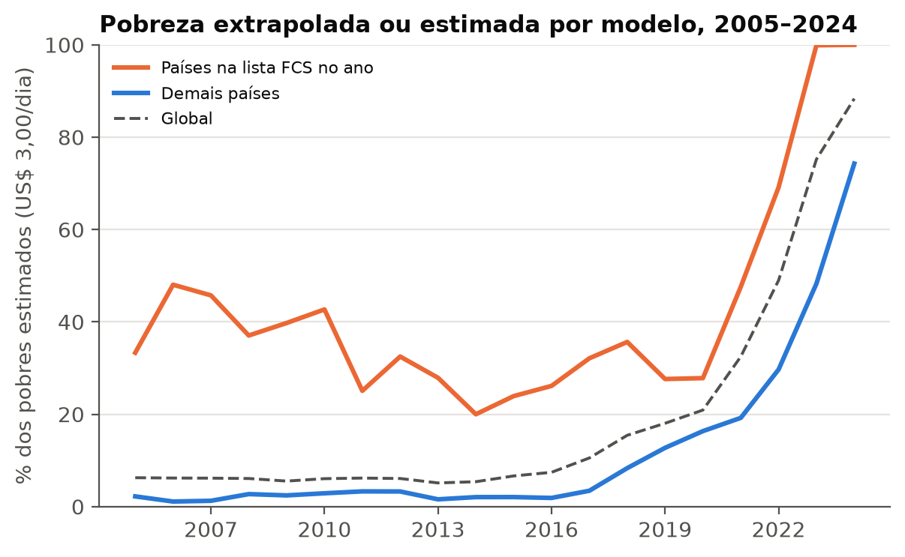
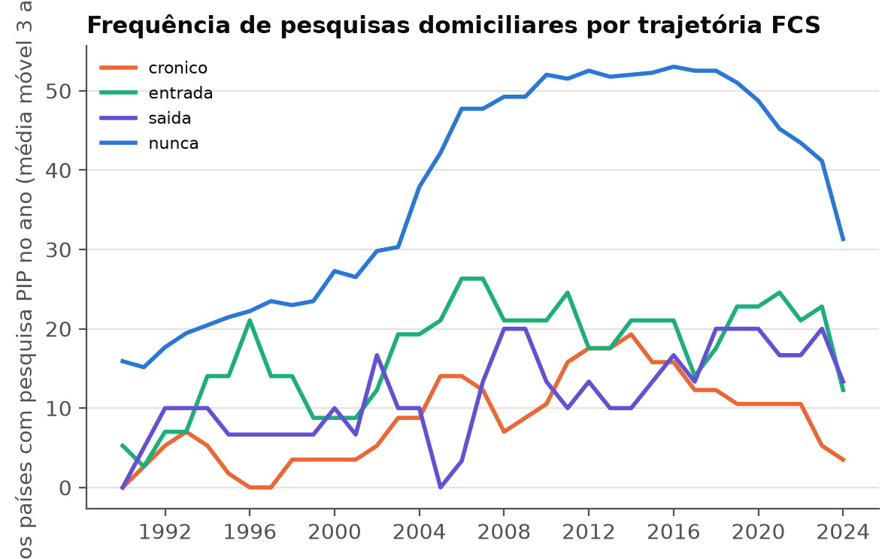
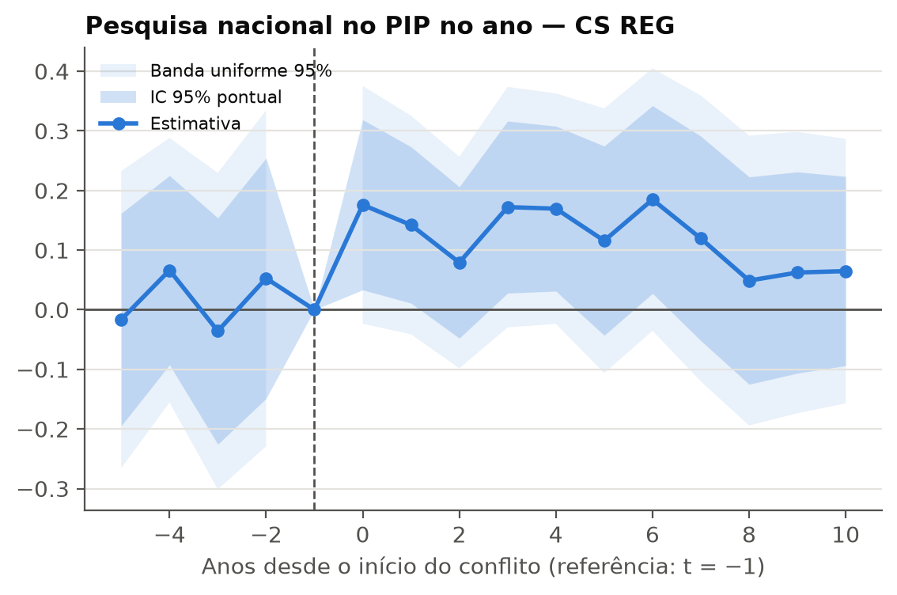
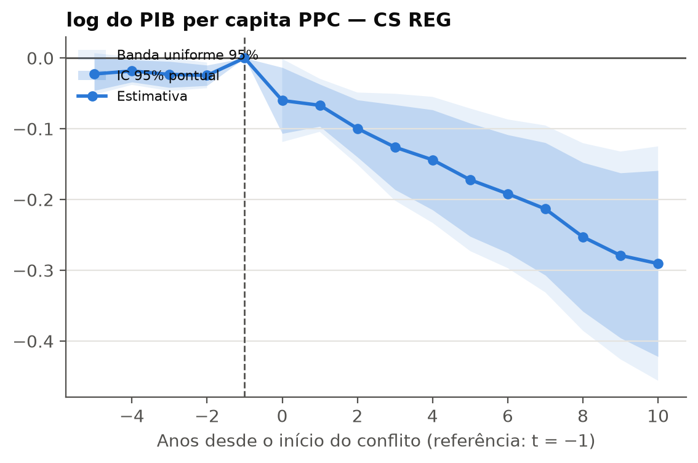
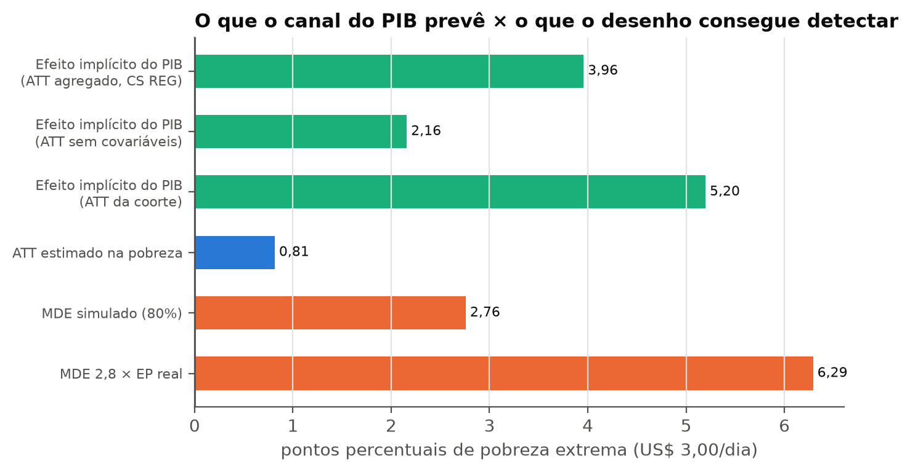

# Medindo no escuro: conflito armado, apagão estatístico e os limites da evidência sobre pobreza (rodada 2)

*Relatório gerado por `src/r2/07_report.py` a partir de `outputs/r2/`. Instruções: `CLAUDE.md` (rodada 2); rodada 1 em `docs/CLAUDE_rodada1.md`, `report/report.md` e `report/exercicios.md`.*

## Resumo

- **Estatística-título.** Em 2005–2019, **32,5%** dos pobres estimados (US$ 3,00/dia) que viviam em países da lista FCS estavam em país-anos cuja pobreza é **extrapolada ou estimada por modelo** no PIP, contra **2,8%** fora da lista. Os países FCS passaram de 16,4% dos pobres do mundo (média 2005–2019) para 54,7% em 2024. Ou seja, a pobreza mundial se concentra justamente onde ela é menos medida.
- **O apagão é um estoque, não um choque.** Países FCS crônicos têm pesquisa nacional no PIP em 8,7% dos anos, contra 37,9% nos que nunca foram FCS. O onset de um conflito no padrão FCS não reduz de forma robusta a frequência de pesquisas: o CS REG dá 0,124 (EP 0,052), mas esse resultado vem de uma queda pontual no ano-base; com estimadores que usam todo o período pré, o efeito é -0,022 (BJS) e 0,051 (DiD empilhada), ambos não significativos.
- **Conflito e PIB.** O onset T1 está associado a um PIB per capita menor em 7,7% a 16,6% (CS sem e com covariáveis). Mas a renda relativa dos tratados já caía antes do onset. Extrapolando a tendência pré, o efeito médio em e ∈ [0,5] vai a -1,6% (IC -6,3%; 3,0%). Causalidade reversa e efeito do conflito não se separam com estes dados.
- **O que o desenho consegue ver.** Pela própria regra de extrapolação do PIP (distribuição constante), a queda do PIB estimada implica +4,0 p.p. de pobreza extrema em média nos 6 primeiros anos (+2,2 p.p. com o ATT sem covariáveis). O efeito mínimo detectável do desenho é 6,3 p.p.; o ATT estimado na pobreza é 0,81 p.p. **Nem o efeito mecânico produzido pelo próprio modelo do PIP seria detectável com segurança.**
- **Conclusão.** Com os dados nacionais disponíveis, a pergunta "quanto o conflito aumenta a pobreza" não tem resposta empírica. Nos países FCS, 95,4% dos pobres estimados em 2005–2019 estavam em anos sem pesquisa (interpolados ou extrapolados); nos anos de conflito, a pobreza publicada é, em boa parte, a projeção do PIB por um modelo. E o desenho não teria poder nem para detectar esse efeito projetado. Isso não é evidência de que o conflito não afeta a pobreza.

## 1. Fontes, versões e limiares FCS

Bases novas desta rodada (`data/raw/MANIFEST.csv`, com URL e SHA-256 completos); as da rodada 1 (PIP 20260922, UCDP 26.1, WDI, WGI, UNHCR, COW) não mudaram de versão e foram reutilizadas.

| arquivo | fonte | versao | data_download | sha256 | licenca_termos |
|---|---|---|---|---|---|
| fcs_classification_page.html | WB-FCS | página (22324 bytes) | 2026-10-16 | a2fe5e683cde… | CC BY 4.0 (World Bank Open Data terms) |
| fcs_list_FY06_FY26.pdf | WB-FCS | publicado s/d (FY27, página FCS) | 2026-10-16 | d444f08dc035… | CC BY 4.0 (World Bank Open Data terms); documento publicado na página pública FCS |
| fcs_historical_note_FY27.pdf | WB-FCS | publicado 20260702 (FY27, página FCS) | 2026-10-16 | ddb7f491ca67… | CC BY 4.0 (World Bank Open Data terms); documento publicado na página pública FCS |
| fcv_methodology_summary_FY27.pdf | WB-FCS | publicado 20260702 (FY27, página FCS) | 2026-10-16 | f19358f4a34e… | CC BY 4.0 (World Bank Open Data terms); documento publicado na página pública FCS |
| fcv_list_FY27.pdf | WB-FCS | publicado 20260702 (FY27, página FCS) | 2026-10-16 | 25c5c416b8b5… | CC BY 4.0 (World Bank Open Data terms); documento publicado na página pública FCS |
| institutional_fragility_list_FY27.pdf | WB-FCS | publicado 20260702 (FY27, página FCS) | 2026-10-16 | 0406a4b7595a… | CC BY 4.0 (World Bank Open Data terms); documento publicado na página pública FCS |
| dhs_surveys.json | DHS | API REST, 477 pesquisas | 2026-10-16 | 1cb8a0815b77… | DHS Program API — metadados públicos |
| ophi_global_mpi.csv | OPHI | HDX (global MPI, OPHI) | 2026-10-16 | 6b3e443d8626… | OPHI/HDX — CC BY |
| ophi_global_mpi_trends.csv | OPHI | HDX (global MPI, OPHI) | 2026-10-16 | c4ea2454eac2… | OPHI/HDX — CC BY |
| undp_gmpi_2025_table1and2.xlsx | UNDP-HDRO | gMPI 2025 | 2026-10-16 | 0f8080a749ce… | UNDP HDRO — uso livre com citação |
| wb_mpm_AM26.xlsx | WB-MPM | MPM Annual Meetings 2026 | 2026-10-16 | bf14d09a3850… | CC BY 4.0 (World Bank Open Data terms) |
| idmc_conflict_disasters.xlsx | IDMC | GIDD via HDX (release 39) | 2026-10-16 | aef0742ce517… | IDMC — CC BY-NC 4.0 (uso não comercial) |
| dpo_operationslist.pdf | UN-DPO | baixado 2026-10-16 | 2026-10-16 | 1b43b2d25b53… | United Nations — conteúdo público do site de peacekeeping |
| dpo_past_operations.html | UN-DPO | baixado 2026-10-16 | 2026-10-16 | d8a0e2036e60… | United Nations — conteúdo público do site de peacekeeping |
| dpo_where_we_operate.html | UN-DPO | baixado 2026-10-16 | 2026-10-16 | fb0b511c0d06… | United Nations — conteúdo público do site de peacekeeping |
| zenodo_nightlights_search.json | Zenodo | busca | 2026-10-16 | 5ab0ad7d1a7e… | metadados Zenodo |
| mics_surveys.json | MICS | API pública, 386 pesquisas em 43 páginas | 2026-10-16 | e3021ef9a5e6… | UNICEF MICS — catálogo público de pesquisas (metadados) |
| ipi_pko_mission_level.csv | IPI-PKO | HDX (dados até 2017-04) | 2026-10-16 | 4fd121e58566… | Public Domain / CC0 (HDX) |
| wb_cpia.csv | WB-CPIA | lastupdated=2026-08-03; 21 indicadores | 2026-10-16 | af0e0f987972… | CC BY 4.0 (World Bank Open Data terms) |
| wb_spi.csv | WB-SPI | lastupdated=2024-11-11; 72 indicadores | 2026-10-16 | fb6cd9d0aaf2… | CC BY 4.0 (World Bank Open Data terms) |
| pip_passthrough_queries.json | PIP | 20260922_2021_01_02_PROD | 2026-10-16 | d057533b1b56… | CC BY 4.0 (World Bank Open Data terms) |

**Metodologia FCS.** A nota vigente é a *FY2027 Public FCV List — Methodology Summary* (efetiva em 1/7/2026), que usa só ACLED subnacional, WorldPop e GADM. Os critérios de dupla fonte (ACLED e UCDP) da era FY20–26 estão na *Historical Overview* publicada na mesma página. Por decisão do usuário, a FY20–26 é a regra principal e a FY27 é variante. Todos os valores abaixo foram extraídos do texto das notas e conferidos contra o trecho citado (`fcs_thresholds_used.csv`). Observação: o PDF da nota histórica traz a marcação "Official Use Only", mas está publicado em link aberto na página pública de classificação FCS; o usuário autorizou seu uso.

| metodologia | criterio | fonte_dados | valor | unidade | documento | versao_documento |
|---|---|---|---|---|---|---|
| FY20-26 | alta: mortes absolutas > | ACLED | 250,00 | mortes | fcs_historical_note_FY27.pdf | publicado 20260702 (FY27, página FCS) |
| FY20-26 | alta: mortes absolutas > | UCDP | 150,00 | mortes | fcs_historical_note_FY27.pdf | publicado 20260702 (FY27, página FCS) |
| FY20-26 | alta: mortes per capita > | ACLED e UCDP | 10,00 | por 100 mil | fcs_historical_note_FY27.pdf | publicado 20260702 (FY27, página FCS) |
| FY20-26 | media: mortes absolutas > | ACLED | 250,00 | mortes | fcs_historical_note_FY27.pdf | publicado 20260702 (FY27, página FCS) |
| FY20-26 | media: mortes absolutas > | UCDP | 150,00 | mortes | fcs_historical_note_FY27.pdf | publicado 20260702 (FY27, página FCS) |
| FY20-26 | media: per capita entre (min) | ACLED | 2,00 | por 100 mil | fcs_historical_note_FY27.pdf | publicado 20260702 (FY27, página FCS) |
| FY20-26 | media: per capita entre (max) | ACLED | 10,00 | por 100 mil | fcs_historical_note_FY27.pdf | publicado 20260702 (FY27, página FCS) |
| FY20-26 | media: per capita entre (min) | UCDP | 1,00 | por 100 mil | fcs_historical_note_FY27.pdf | publicado 20260702 (FY27, página FCS) |
| FY20-26 | media: per capita entre (max) | UCDP | 10,00 | por 100 mil | fcs_historical_note_FY27.pdf | publicado 20260702 (FY27, página FCS) |
| FY20-26 | deterioracao rapida: per capita entre (min) | ACLED | 1,00 | por 100 mil | fcs_historical_note_FY27.pdf | publicado 20260702 (FY27, página FCS) |
| FY20-26 | deterioracao rapida: per capita entre (max) | ACLED | 2,00 | por 100 mil | fcs_historical_note_FY27.pdf | publicado 20260702 (FY27, página FCS) |
| FY20-26 | deterioracao rapida: per capita entre (min) | UCDP | 0,50 | por 100 mil | fcs_historical_note_FY27.pdf | publicado 20260702 (FY27, página FCS) |
| FY20-26 | deterioracao rapida: per capita entre (max) | UCDP | 1,00 | por 100 mil | fcs_historical_note_FY27.pdf | publicado 20260702 (FY27, página FCS) |
| FY20-26 | deterioracao rapida: mortes mais que dobram no ano | ACLED e UCDP | 2,00 | razão | fcs_historical_note_FY27.pdf | publicado 20260702 (FY27, página FCS) |
| FY20-26 | fragilidade: CPIA < | CPIA (menor entre WB, AfDB, ADB) | 3,00 | nota | fcs_historical_note_FY27.pdf | publicado 20260702 (FY27, página FCS) |
| FY20-26 | fragilidade: refugiados por 100 mil >= | UNHCR | 2.000,00 | por 100 mil | fcs_historical_note_FY27.pdf | publicado 20260702 (FY27, página FCS) |
| FY27 | unidade afetada: mortes per capita >= | ACLED (subnacional) | 2,00 | por 100 mil | fcv_methodology_summary_FY27.pdf | publicado 20260702 (FY27, página FCS) |
| FY27 | unidade afetada: mortes >= | ACLED (subnacional) | 2,00 | mortes | fcs_historical_note_FY27.pdf | publicado 20260702 (FY27, página FCS) |
| FY27 | populacao em unidades afetadas >= | ACLED + WorldPop | 20,00 | % | fcv_methodology_summary_FY27.pdf | publicado 20260702 (FY27, página FCS) |
| FY27 | mortes totais >= | ACLED | 50,00 | mortes | fcv_methodology_summary_FY27.pdf | publicado 20260702 (FY27, página FCS) |
| FY27 | violencia claramente politica > ambigua | ACLED (tipo de ator) | 1,00 | razão | fcs_historical_note_FY27.pdf | publicado 20260702 (FY27, página FCS) |
| FY27 | continuidade: sai após n períodos abaixo | - | 2,00 | períodos | fcv_methodology_summary_FY27.pdf | publicado 20260702 (FY27, página FCS) |
| regra propria | eventos concentrados: descarta país-ano se > share das mortes em janela de dias | UCDP GED (datas) | 0,75 | share (janela 3 dias) | - | - |

**Regra de eventos concentrados.** Não consta de nenhuma das notas publicadas. Foi aplicada como regra própria, documentada: descarta-se o país-ano em que mais de 75% das mortes do GED ocorreram numa janela de 3 dias (eventos com várias datas têm as mortes distribuídas entre o início e o fim). Foram descartados 18 país-anos: ARM 2022, AZE 2022, AZE 2023, BDI 2014, BIH 1995, GIN 2001, GIN 2009, GIN 2013, HTI 1991, HTI 2018, KWT 1991, LBR 1992, LKA 2019, NER 1989, NER 1990, TJK 2022, USA 2001, VEN 1994. Os resultados sem a regra estão no §8.

**ACLED.** Não baixado: as credenciais (`ACLED_EMAIL`, `ACLED_KEY`) não foram fornecidas. T1 usa só os critérios UCDP (`t1_source = "ucdp_only"`), e a variante de dupla fonte e a FY27 ficam pendentes.

**Luminosidade noturna.** Não incluída: só a busca de metadados no Zenodo foi registrada. A agregação por país das imagens harmonizadas exigiria fronteiras (GADM) e processamento de rasters, fora do escopo desta rodada.

## 2. O que mudou em relação à rodada 1

- **Tratamento T1 (padrão FCS, UCDP-only).** Um país-ano está em conflito se tiver > 150 mortes e > 10/100 mil (alta), > 150 mortes e 1–10/100 mil (média), ou 0,5–1/100 mil com mortes mais que dobrando (deterioração rápida). As mortes são o total de violência organizada no território (UCDP Country-Year: state-based, non-state e one-sided). O onset é o 1º ano em T1 após ≥ 5 anos fora, sem exigir pesquisas (exceto na Q3). Resultado: 45 tratados, 99 controles (nunca T1 e nunca FCS) e 33 países sempre em conflito T1 (sem janela de paz), que ficam fora do desenho de onset mas entram no contínuo (T3) e nas descritivas.
- **Comparação com a rodada 1 (25 mortes):** 18 tratados em comum; saem 15 (BEN BGD CHN GBR JOR MRT MYS PER SEN THA TJK TUN TZA USA VEN); entram 27 (BRA CAF COG COL ECU ERI ETH GHA GIN GNB HND HTI ISR LBN LBY NPL PAK PHL PNG RUS SRB SSD TCD TUR UZB YEM ZWE). EUA, Reino Unido e China saem; entram casos graves antes excluídos por falta de pesquisa, como RDC, Etiópia, Iêmen, Sudão do Sul e Líbia (`treatment_comparison_r1_r2.csv`).
- **Nota sobre a violência criminal.** As mortes totais incluem violência não estatal. Por isso entram onsets ligados ao crime organizado (MEX 2006, HND 2003, BRA 2017, ECU 2021, COL 2023). A variante só com mortes state-based está no §8.
- **T2 (status FCS).** 22 listas (FY06–FY27; `fcs_counts_by_fy.csv`). Trajetórias (crônico = na lista em ≥ 80% dos anos de existência): cronico 20; entrada 19; intermitente 14; saida 10. A categoria "intermitente" foi acrescentada para quem entra e sai. Os países marginais de FY06–09 ficam fora (eram listados "para monitoramento"). **T2 não é usado como tratamento causal**: a lista é construída em parte com o CPIA, que reflete o desempenho econômico e institucional (circularidade).

| fy | na lista | marginal | conflito | institucional |
|---|---|---|---|---|
| 2006 | 28 | 7 | — | — |
| 2007 | 26 | 9 | — | — |
| 2008 | 26 | 8 | — | — |
| 2009 | 25 | 10 | — | — |
| 2010 | 35 | 0 | — | — |
| 2011 | 31 | 0 | — | — |
| 2012 | 33 | 0 | — | — |
| 2013 | 34 | 0 | — | — |
| 2014 | 35 | 0 | — | — |
| 2015 | 33 | 0 | — | — |
| 2016 | 35 | 0 | — | — |
| 2017 | 35 | 0 | — | — |
| 2018 | 36 | 0 | — | — |
| 2019 | 36 | 0 | — | — |
| 2020 | 37 | 0 | 16 | 21 |
| 2021 | 39 | 0 | 17 | 22 |
| 2022 | 39 | 0 | 22 | 17 |
| 2023 | 37 | 0 | 17 | 20 |
| 2024 | 39 | 0 | 19 | 20 |
| 2025 | 39 | 0 | 21 | 18 |
| 2026 | 38 | 0 | 21 | 17 |
| 2027 | 38 | 0 | 24 | 25 |

## 3. Anatomia do apagão

A estatística-título é recalculada diretamente do CSV bruto do PIP, com diferença máxima de 0e+00 em 35 anos (`anatomy_title_stat_check.csv`). "Extrapolada ou modelada" = `estimation_type` ∈ {extrapolation, CMD estimation}; a variante "modelada" inclui também a interpolação entre pesquisas.

| periodo | grupo | % pobres extrapolada/modelo | % pobres não-pesquisa | pobres (mi) | % dos pobres do mundo em FCS |
|---|---|---|---|---|---|
| 2005-2019 | global | 0,072 | 0,793 | 1.295 | 0,164 |
| 2005-2019 | FCS no ano | 0,325 | 0,954 | 190 | 0,164 |
| 2005-2019 | não FCS | 0,028 | 0,765 | 1.105 | 0,164 |
| 2020-2024 | global | 0,524 | 0,882 | 865 | 0,484 |
| 2020-2024 | FCS no ano | 0,709 | 0,930 | 418 | 0,484 |
| 2020-2024 | não FCS | 0,350 | 0,837 | 447 | 0,484 |
| 2024 | global | 0,883 | 0,951 | 824 | 0,547 |
| 2024 | FCS no ano | 1,000 | 1,000 | 451 | 0,547 |
| 2024 | não FCS | 0,743 | 0,893 | 373 | 0,547 |

A alta de 2020–2024 em todos os grupos reflete a defasagem normal das pesquisas mais recentes (anos ainda não cobertos por pesquisa são projetados), e não só o conflito. Por isso a comparação substantiva usa 2005–2019.

**Por trajetória FCS** (média dos países-ano 1990–2024; `anatomy_summary_by_trajectory.csv`):

| trajetoria | n_paises | share_survey_pip | share_survey_any | anos_desde_pesquisa | share_extrap | spi_medio | dhs_por_decada | mics_por_decada |
|---|---|---|---|---|---|---|---|---|
| cronico | 19 | 0,087 | 0,220 | 3,700 | 0,641 | 44,483 | 0,526 | 0,887 |
| entrada | 19 | 0,170 | 0,257 | 3,135 | 0,466 | 48,090 | 0,647 | 0,586 |
| intermitente | 13 | 0,255 | 0,411 | 2,701 | 0,343 | 59,514 | 1,055 | 1,055 |
| nunca | 132 | 0,379 | 0,435 | 1,759 | 0,367 | 71,182 | 0,444 | 0,400 |
| saida | 10 | 0,120 | 0,260 | 2,944 | 0,494 | 55,615 | 0,886 | 0,829 |

**Países que a rodada 1 excluiu.** Dos 29 excluídos por falta de pesquisas antes do onset, 21 já estiveram na lista FCS. Juntos, representam 21,7% da pobreza extrema global estimada em 2024. Os 31 "sempre tratados" somam mais 32,6%. A rodada 1 deixou de fora, portanto, países com 54,2% dos pobres do mundo (`anatomy_r1_excluded.csv`).

## 4. Conflito e produção de dados (Q2)

| outcome | estimator | estimate | se | ci_low | ci_high | p_value | n_treated | pretrend_p |
|---|---|---|---|---|---|---|---|---|
| survey_pip | CS REG, nunca tratados | 0,124 | 0,052 | 0,022 | 0,227 | 0,018 | 42 | 0,826 |
| survey_pip | CS REG, ainda não tratados | 0,123 | 0,051 | 0,024 | 0,223 | 0,015 | 42 | 0,813 |
| survey_pip | CS sem covariáveis, nunca tratados | 0,089 | 0,051 | -0,010 | 0,188 | 0,078 | 45 | 0,785 |
| survey_pip | BJS/did2s (imputação, base = todo o pré) | -0,022 | 0,046 | -0,112 | 0,069 | 0,635 | 45 | — |
| survey_pip | DiD empilhada de médias (g−5..g−1 × g..g+5) | 0,051 | 0,039 | -0,025 | 0,127 | 0,192 | 45 | — |
| survey_pip | DiD empilhada de médias — só alta intensidade | 0,030 | 0,043 | -0,054 | 0,114 | 0,488 | 29 | — |
| survey_any | CS REG, nunca tratados | -0,011 | 0,084 | -0,176 | 0,154 | 0,894 | 42 | 0,330 |
| survey_any | CS REG, ainda não tratados | -0,018 | 0,078 | -0,170 | 0,134 | 0,819 | 42 | 0,467 |
| survey_any | CS sem covariáveis, nunca tratados | -0,058 | 0,074 | -0,202 | 0,086 | 0,428 | 45 | 0,140 |
| survey_any | BJS/did2s (imputação, base = todo o pré) | -0,065 | 0,045 | -0,154 | 0,024 | 0,152 | 45 | — |
| survey_any | DiD empilhada de médias (g−5..g−1 × g..g+5) | -0,015 | 0,041 | -0,095 | 0,065 | 0,713 | 45 | — |
| survey_any | DiD empilhada de médias — só alta intensidade | 0,023 | 0,048 | -0,071 | 0,116 | 0,636 | 29 | — |
| share_extrapolated | CS REG, nunca tratados | -0,076 | 0,057 | -0,188 | 0,036 | 0,185 | 42 | 0,066 |
| share_extrapolated | CS REG, ainda não tratados | -0,072 | 0,055 | -0,179 | 0,035 | 0,186 | 42 | 0,022 |
| share_extrapolated | CS sem covariáveis, nunca tratados | -0,055 | 0,051 | -0,154 | 0,045 | 0,281 | 45 | 0,002 |
| share_extrapolated | BJS/did2s (imputação, base = todo o pré) | -0,117 | 0,051 | -0,217 | -0,017 | 0,022 | 45 | — |
| share_extrapolated | DiD empilhada de médias (g−5..g−1 × g..g+5) | -0,116 | 0,043 | -0,200 | -0,032 | 0,007 | 45 | — |
| share_extrapolated | DiD empilhada de médias — só alta intensidade | 0,007 | 0,053 | -0,097 | 0,112 | 0,891 | 29 | — |
| survey_pip | LPM TWFE (como rodada 1) | -0,032 | 0,042 | -0,114 | 0,051 | 0,449 | 45 | — |
| survey_any | LPM TWFE (como rodada 1) | -0,081 | 0,042 | -0,164 | 0,002 | 0,055 | 45 | — |
| share_extrapolated | LPM TWFE (como rodada 1) | -0,094 | 0,049 | -0,192 | 0,004 | 0,060 | 45 | — |
| survey_pip | Rodada 1 (onset 25 mortes, LPM TWFE) | -0,082 | 0,041 | — | — | 0,045 | 33 | — |

**Leitura.** O CS REG sugere *mais* pesquisas após o onset (0,124). O event study, porém, mostra que o ano-base g−1 tem um coeficiente atípico: com base variável, o CS compara cada ano a g−1. Os estimadores que usam todo o período pré como base (BJS -0,022; DiD empilhada 0,051) não indicam efeito. A regressão TWFE da rodada 1 aplicada ao T1 dá -0,032, contra −0,082 na rodada 1. O efeito negativo da rodada 1 não se reproduz com a definição FCS de conflito.
- **A definição do tratamento muda o sinal.** Com os tratados da rodada 1 (onset com ≥ 25 mortes) e os mesmos estimadores, o efeito sobre a frequência de pesquisas é -0,099 (CS REG) e -0,056 (DiD empilhada). A queda de pesquisas encontrada na rodada 1 é compatível com onsets de baixa intensidade que o limiar FCS (> 150 mortes e ≥ 0,5–1/100 mil) exclui: saem BEN BGD CHN GBR JOR MRT MYS PER SEN THA TJK TUN TZA USA VEN.
- **Pontos extrapolados.** A DiD empilhada indica *menos* pontos extrapolados após o onset (-0,116, p < 0,05), e o resultado não se mantém só com conflitos de alta intensidade. A leitura cautelosa é que os onsets T1 estão concentrados em países de renda média com sistemas estatísticos ativos.
- **Heterogeneidade** (DiD empilhada; Holm em `survey_effect_heterogeneity.csv`). Em tratados de trajetória FCS crônica ou de entrada, a probabilidade de alguma pesquisa cai -0,077 (p = 0,093). Em tratados nunca FCS, o sinal se inverte. Nenhuma heterogeneidade sobrevive à correção de Holm.
- **Missões de paz e CPIA:** medidos antes do onset; os subgrupos têm 5–9 tratados e não permitem conclusão.
- **Intensidade contínua (WAOSS):** θ = 0,0215 (EP 0,0226) por unidade de asinh(mortes/100 mil); o efeito das escaladas, líquido do placebo, é 0,0024 (EP 0,0552).

**Síntese da Q2.** O conflito não *cria* o apagão no momento do onset: ele se concentra nos países cronicamente frágeis, que nunca entram num desenho de onset porque não têm um período de paz para servir de base. É um problema de estoque, visível nas descritivas (§3), e não de fluxo identificável por DiD.

## 5. Conflito e PIB per capita (Q1)

| outcome | estimator | estimate | se | ci_low | ci_high | p_value | n_treated | pretrend_p |
|---|---|---|---|---|---|---|---|---|
| ln_gdppc | CS REG, nunca tratados | -0,1658 | 0,0363 | -0,237 | -0,095 | 0,000 | 40 | 0,022 |
| ln_gdppc | CS REG, ainda não tratados | -0,1325 | 0,0295 | -0,190 | -0,075 | 0,000 | 40 | 0,092 |
| ln_gdppc | CS sem covariáveis, nunca tratados | -0,0768 | 0,0250 | -0,126 | -0,028 | 0,002 | 40 | 0,337 |
| ln_gdppc | CS REG, antecipação 1 | -0,2059 | 0,0424 | -0,289 | -0,123 | 0,000 | 40 | 0,006 |
| ln_gdppc | CS REG, antecipação 2 | -0,2320 | 0,0469 | -0,324 | -0,140 | 0,000 | 40 | 0,005 |
| ln_gdppc | Sun-Abraham (IW) | -0,0894 | 0,0199 | -0,129 | -0,050 | 0,000 | — | — |
| ln_gdppc | BJS/did2s | -0,1396 | 0,0428 | -0,224 | -0,056 | 0,001 | 42 | — |
| ln_gdppc | DiD empilhada de médias | -0,1034 | 0,0261 | -0,154 | -0,052 | 0,000 | 42 | — |
| ln_gdppc | CS REG — só alta intensidade | -0,1556 | 0,0539 | -0,261 | -0,050 | 0,004 | 24 | 0,344 |
| ln_gdppc | CS REG — janela de paz 3 | -0,2193 | 0,0479 | -0,313 | -0,125 | 0,000 | 52 | 0,005 |
| ln_gdppc | CS REG — janela de paz 10 | -0,1519 | 0,0394 | -0,229 | -0,075 | 0,000 | 28 | 0,010 |
| ln_gdppc | CS REG — mortes state-based | -0,1756 | 0,0398 | -0,254 | -0,098 | 0,000 | 34 | 0,020 |
| ln_gdppc | CS REG — sem regra de eventos concentrados | -0,1563 | 0,0331 | -0,221 | -0,092 | 0,000 | 44 | 0,061 |
| ln_gdppc | CS REG — controles com fragilidade institucional | -0,1102 | 0,0289 | -0,167 | -0,054 | 0,000 | 40 | 0,171 |
| ln_gdppc | Placebo por permutação (CS sem X; 500) | -0,0768 | 0,0291 | — | — | 0,006 | 45 | — |
| gdppc_growth | CS REG, nunca tratados | 0,0151 | 0,0097 | -0,004 | 0,034 | 0,118 | 40 | 0,863 |
| gdppc_growth | CS REG, ainda não tratados | 0,0147 | 0,0098 | -0,004 | 0,034 | 0,132 | 40 | 0,836 |
| gdppc_growth | CS sem covariáveis, nunca tratados | 0,0208 | 0,0093 | 0,003 | 0,039 | 0,025 | 40 | 0,873 |
| gdppc_growth | CS REG, antecipação 1 | 0,0012 | 0,0074 | -0,013 | 0,016 | 0,870 | 40 | 0,405 |
| gdppc_growth | CS REG, antecipação 2 | -0,0014 | 0,0095 | -0,020 | 0,017 | 0,886 | 40 | 0,381 |
| gdppc_growth | Sun-Abraham (IW) | 0,0145 | 0,0058 | 0,003 | 0,026 | 0,014 | — | — |
| gdppc_growth | BJS/did2s | 0,0011 | 0,0073 | -0,013 | 0,015 | 0,885 | 42 | — |
| gdppc_growth | DiD empilhada de médias | -0,0007 | 0,0072 | -0,015 | 0,013 | 0,925 | 42 | — |
| gdppc_growth | CS REG — só alta intensidade | 0,0057 | 0,0109 | -0,016 | 0,027 | 0,600 | 24 | 0,326 |
| gdppc_growth | CS REG — janela de paz 3 | 0,0187 | 0,0121 | -0,005 | 0,042 | 0,122 | 52 | 0,299 |
| gdppc_growth | CS REG — janela de paz 10 | 0,0136 | 0,0118 | -0,010 | 0,037 | 0,251 | 28 | 0,576 |
| gdppc_growth | CS REG — mortes state-based | -0,0086 | 0,0129 | -0,034 | 0,017 | 0,507 | 34 | 0,828 |
| gdppc_growth | CS REG — sem regra de eventos concentrados | 0,0138 | 0,0096 | -0,005 | 0,033 | 0,151 | 44 | 0,957 |
| gdppc_growth | CS REG — controles com fragilidade institucional | 0,0158 | 0,0094 | -0,003 | 0,034 | 0,091 | 40 | 0,747 |
| gdppc_growth | Placebo por permutação (CS sem X; 500) | 0,0208 | 0,0076 | — | — | 0,014 | 45 | — |

**Pré-tendências (causalidade reversa).** Os coeficientes pré-onset do CS REG para ln PIB pc (e = −5…−2, base variável) são -0,023, -0,018, -0,023, -0,025, e o teste conjunto rejeita (p = 0,022). Os tratados já perdiam renda relativa antes do onset, o que é compatível com choques de renda que aumentam o risco de conflito. Sem covariáveis, o teste não rejeita (p = 0,337) e o efeito é menor (-0,0768).
**Rambachan–Roth (aprox.; média e ∈ [0,5]):**

| M | theta | ci_low | ci_high |
|---|---|---|---|
| 0 | -0,1115 | -0,1566 | -0,0647 |
| 0,5 | -0,1115 | -0,2440 | -0,0049 |
| 1 | -0,1115 | -0,3374 | 0,0799 |
| 1,5 | -0,1115 | -0,4325 | 0,1734 |
| 2 | -0,1115 | -0,5282 | 0,2684 |
| SD(0): tendência linear extrapolada | -0,0165 | -0,0629 | 0,0305 |

O IC robusto do efeito sobre o nível do PIB exclui zero até M̄ = 0,5 vez a maior variação pré. Sob a extrapolação linear da tendência pré, o efeito é -1,6% (IC -6,3%; 3,0%). O crescimento anual não mostra efeito robusto.
- **T3 contínuo:** θ = -0,0179 log-pontos por unidade de asinh (EP 0,0041). Nas escaladas, o efeito é -0,0221, mas o placebo das escaladas também é negativo (-0,0097, EP 0,0058). Líquido do placebo: -0,0124 (EP 0,0089), não significativo.
- **Medição do PIB:** as contas nacionais também se deterioram em conflito. A robustez com luminosidade noturna não foi possível nesta rodada.

## 6. O que o canal do PIB prevê e o que o desenho consegue detectar (Q3)

Tratados elegíveis: 22 países com ≥ 3 pesquisas antes do onset e distribuição observada antes dele. Para cada um, a API do PIP foi consultada na última pesquisa pré-onset com a linha 3,00/(1 − x), em que x é a queda estimada do PIB per capita (`passthrough_by_country.csv`).

| variante | e | queda_pib | delta_pp |
|---|---|---|---|
| ATT agregado | 0 | 0,058 | 2,123 |
| ATT agregado | 1 | 0,065 | 2,343 |
| ATT agregado | 2 | 0,095 | 3,556 |
| ATT agregado | 3 | 0,118 | 4,484 |
| ATT agregado | 4 | 0,134 | 5,114 |
| ATT agregado | 5 | 0,158 | 6,121 |
| ATT agregado sem covariáveis | 0 | 0,049 | 1,695 |
| ATT agregado sem covariáveis | 1 | 0,043 | 1,456 |
| ATT agregado sem covariáveis | 2 | 0,058 | 2,010 |
| ATT agregado sem covariáveis | 3 | 0,069 | 2,452 |
| ATT agregado sem covariáveis | 4 | 0,068 | 2,452 |
| ATT agregado sem covariáveis | 5 | 0,078 | 2,882 |
| ATT da coorte | 0 | 0,113 | 5,197 |
| ATT da coorte | 1 | 0,113 | 5,197 |
| ATT da coorte | 2 | 0,113 | 5,197 |
| ATT da coorte | 3 | 0,113 | 5,197 |
| ATT da coorte | 4 | 0,113 | 5,197 |
| ATT da coorte | 5 | 0,113 | 5,197 |

| variante | delta_pp_medio | delta_pp_mediana | n_paises |
|---|---|---|---|
| ATT agregado | 3,957 | 3,850 | 22 |
| ATT agregado sem covariáveis | 2,158 | 2,241 | 22 |
| ATT da coorte | 5,197 | 1,910 | 22 |

**Efeito mínimo detectável** (simulação placebo, 500 réplicas por δ, 22 falsos tratados sorteados de 94 nunca tratados): tamanho em δ = 0 = 4,8%; MDE simulado = 2,76 p.p.; 2,8 × EP real = 6,29 p.p.; referência (o maior) = **6,29 p.p.**

**Resposta à pergunta-chave.** O efeito mecânico que o próprio modelo do PIP produz a partir da queda do PIB (+3,96 p.p., ou +2,16 p.p. sem covariáveis) é **menor que o efeito mínimo detectável** (6,29 p.p.). Mesmo que a pobreza publicada fosse exatamente a projeção do PIB, o desenho não a distinguiria de zero com 80% de poder. O ATT estimado na pobreza (0,81 p.p., IC [-3,589; 5,219]) é compatível com zero e também com o efeito projetado.

**Ressalva.** O efeito projetado fica *entre* as duas medidas de MDE: acima do MDE simulado (2,76 p.p.) e abaixo de 2,8 × EP real (6,29 p.p.). A simulação sorteia falsos tratados entre nunca tratados, cuja pobreza é mais baixa e estável (EP simulado 0,96 contra EP real 2,25). Por isso o MDE simulado é otimista para os tratados reais, e o critério conservador (o maior dos dois, como na rodada 1) é o relevante.

## 7. Medidas alternativas: pobreza medida, MPI e diferenças longas

| outcome | estimator | estimate | se | ci_low | ci_high | p_value | n_treated | nota |
|---|---|---|---|---|---|---|---|---|
| pov_rate | CS REG, nunca tratados | 0,815 | 2,247 | -3,589 | 5,219 | 0,717 | 22 | principal |
| pov_rate | CS REG, ainda não tratados | 0,364 | 2,126 | -3,802 | 4,530 | 0,864 | 22 | principal |
| pov_rate | CS sem covariáveis, nunca tratados | -2,401 | 2,356 | -7,018 | 2,216 | 0,308 | 22 | principal |
| pov_rate | DiD empilhada de médias | -0,784 | 1,419 | -3,565 | 1,996 | 0,580 | 22 | principal |
| ln_n_poor | CS REG, nunca tratados | 0,397 | 0,165 | 0,073 | 0,722 | 0,016 | 19 | só robustez (efeito em log depende da escala) |
| ln_n_poor | CS REG, ainda não tratados | 0,287 | 0,141 | 0,012 | 0,563 | 0,041 | 19 | só robustez (efeito em log depende da escala) |
| ln_n_poor | CS sem covariáveis, nunca tratados | 0,144 | 0,105 | -0,062 | 0,351 | 0,171 | 19 | só robustez (efeito em log depende da escala) |
| ln_n_poor | DiD empilhada de médias | 0,410 | 0,198 | 0,021 | 0,798 | 0,039 | 21 | só robustez (efeito em log depende da escala) |
| pov_rate_survey_only | CS sem X, blocos de 3 anos, desbalanceado | -3,000 | 1,119 | -5,194 | -0,807 | 0,007 | 22 | 769 unidade-blocos com dado |
| mpi_headcount | CS sem X, blocos de 3 anos, desbalanceado | -1,290 | 0,601 | -2,469 | -0,112 | 0,032 | 22 | 116 unidade-blocos com dado |
| pov_rate_survey_only | Diferenças longas entre pesquisas | -0,205 | 1,338 | -2,828 | 2,418 | 0,878 | 20 | Δ entre última pesquisa pré e primeira pós; controles com intervalo comparável |
| refugees_origin_pc | DiD empilhada de médias (mecanismo) | 499,881 | 351,589 | -189,234 | 1.188,996 | 0,155 | 44 | por 100 mil hab. |
| idp_stock_pc | DiD empilhada de médias (mecanismo) | 3.420,575 | 3.073,345 | -2.603,181 | 9.444,332 | 0,266 | 8 | por 100 mil hab. |
| idp_new_pc | DiD empilhada de médias (mecanismo) | 809,112 | 364,278 | 95,128 | 1.523,097 | 0,026 | 5 | por 100 mil hab. |

- **Diferenças longas entre pesquisas** (20 tratados com pesquisa antes e depois do onset; `poverty_long_differences_pairs.csv`): usam só pobreza medida, mas cobrem poucos países e intervalos longos.
- **Placebo das escaladas (WAOSS):** na série lineup, escalada 0,328 e placebo 0,089 (EP 0,255). Só com pesquisas, escalada -0,111 e placebo 1,325 (EP 0,936), com 159 trocas. O placebo não desaparece com pobreza medida.
- **Só pobreza medida, blocos de 3 anos:** -3,00 p.p. (EP 1,12). Na MPI: -1,29 p.p. (EP 0,60). Os dois são negativos, como na rodada 1, mas são estimados com CS sem covariáveis em blocos desbalanceados: cada bloco reflete os países que fizeram pesquisa naquele período, e quem pesquisa depois do onset é um grupo selecionado (§4). Na série lineup, o mesmo CS sem covariáveis dá -2,40 p.p. (pré-tendência p = 0,91). As diferenças longas, que comparam pares de pesquisas com intervalos parecidos, dão -0,20 p.p. (EP 1,34). Nenhuma medida alternativa indica aumento da pobreza medida após o onset, mas nenhuma tem poder para descartar efeitos de alguns pontos.
- **MPI:** também depende de pesquisas (DHS e MICS) e herda o apagão. A série harmonizada da OPHI cobre poucos país-anos.
- **Mecanismos demográficos:** refugiados que saem aumentam 500 por 100 mil (EP 352; 44 tratados). Novos deslocados internos: 809 por 100 mil (EP 364), mas só 5 tratados têm dados do IDMC (2009+) antes e depois do onset. A população residente do PIP não desconta quem saiu do país.

## 8. Robustez transversal

| pergunta | outcome | especificacao | estimator | estimate | se | p_value | n_treated |
|---|---|---|---|---|---|---|---|
| Q2 | survey_pip | principal (média+, PW 5) | CS REG, nunca tratados | 0,1241 | 0,052 | 0,018 | 42 |
| Q2 | survey_pip | principal (média+, PW 5) | DiD empilhada de médias | 0,0506 | 0,039 | 0,197 | 45 |
| Q2 | survey_pip | só alta intensidade | CS REG, nunca tratados | 0,0554 | 0,055 | 0,315 | 27 |
| Q2 | survey_pip | só alta intensidade | DiD empilhada de médias | 0,0297 | 0,042 | 0,481 | 29 |
| Q2 | survey_pip | janela de paz 3 | CS REG, nunca tratados | 0,1429 | 0,040 | 0,000 | 54 |
| Q2 | survey_pip | janela de paz 3 | DiD empilhada de médias | 0,0578 | 0,032 | 0,075 | 58 |
| Q2 | survey_pip | janela de paz 10 | CS REG, nunca tratados | 0,1053 | 0,075 | 0,159 | 29 |
| Q2 | survey_pip | janela de paz 10 | DiD empilhada de médias | 0,0541 | 0,049 | 0,271 | 30 |
| Q2 | survey_pip | mortes state-based | CS REG, nunca tratados | 0,0817 | 0,071 | 0,249 | 36 |
| Q2 | survey_pip | mortes state-based | DiD empilhada de médias | 0,0392 | 0,042 | 0,352 | 38 |
| Q2 | survey_pip | sem regra de eventos concentrados | CS REG, nunca tratados | 0,0702 | 0,061 | 0,248 | 46 |
| Q2 | survey_pip | sem regra de eventos concentrados | DiD empilhada de médias | 0,0641 | 0,039 | 0,098 | 49 |
| Q2 | survey_pip | controles com fragilidade institucional | CS REG, nunca tratados | 0,1336 | 0,054 | 0,014 | 42 |
| Q2 | survey_pip | controles com fragilidade institucional | DiD empilhada de médias | 0,0541 | 0,038 | 0,150 | 45 |
| Q2 | survey_pip | definição da rodada 1 (25 mortes) | CS REG, nunca tratados | -0,0994 | 0,099 | 0,317 | 32 |
| Q2 | survey_pip | definição da rodada 1 (25 mortes) | DiD empilhada de médias | -0,0562 | 0,045 | 0,214 | 33 |
| Q2 | survey_pip | dupla fonte ACLED + UCDP | - | — | — | — | — |
| Q2 | share_extrapolated | principal (média+, PW 5) | CS REG, nunca tratados | -0,0759 | 0,057 | 0,185 | 42 |
| Q2 | share_extrapolated | principal (média+, PW 5) | DiD empilhada de médias | -0,1159 | 0,041 | 0,004 | 45 |
| Q2 | share_extrapolated | só alta intensidade | CS REG, nunca tratados | -0,0784 | 0,058 | 0,174 | 27 |
| Q2 | share_extrapolated | só alta intensidade | DiD empilhada de médias | 0,0073 | 0,054 | 0,891 | 29 |
| Q2 | share_extrapolated | janela de paz 3 | CS REG, nunca tratados | -0,0955 | 0,053 | 0,073 | 54 |
| Q2 | share_extrapolated | janela de paz 3 | DiD empilhada de médias | -0,1153 | 0,041 | 0,005 | 58 |
| Q2 | share_extrapolated | janela de paz 10 | CS REG, nunca tratados | -0,0774 | 0,077 | 0,317 | 29 |
| Q2 | share_extrapolated | janela de paz 10 | DiD empilhada de médias | -0,0840 | 0,047 | 0,076 | 30 |
| Q2 | share_extrapolated | mortes state-based | CS REG, nunca tratados | -0,0483 | 0,058 | 0,405 | 36 |
| Q2 | share_extrapolated | mortes state-based | DiD empilhada de médias | -0,1000 | 0,042 | 0,016 | 38 |
| Q2 | share_extrapolated | sem regra de eventos concentrados | CS REG, nunca tratados | -0,0802 | 0,055 | 0,142 | 46 |
| Q2 | share_extrapolated | sem regra de eventos concentrados | DiD empilhada de médias | -0,0931 | 0,039 | 0,017 | 49 |
| Q2 | share_extrapolated | controles com fragilidade institucional | CS REG, nunca tratados | -0,0376 | 0,057 | 0,512 | 42 |
| Q2 | share_extrapolated | controles com fragilidade institucional | DiD empilhada de médias | -0,1041 | 0,043 | 0,015 | 45 |
| Q2 | share_extrapolated | definição da rodada 1 (25 mortes) | CS REG, nunca tratados | 0,0177 | 0,052 | 0,736 | 32 |
| Q2 | share_extrapolated | definição da rodada 1 (25 mortes) | DiD empilhada de médias | 0,1039 | 0,046 | 0,023 | 33 |
| Q2 | share_extrapolated | dupla fonte ACLED + UCDP | - | — | — | — | — |
| Q1 | ln_gdppc | principal (média+, PW 5) | CS REG, nunca tratados | -0,1658 | 0,036 | 0,000 | 40 |
| Q1 | ln_gdppc | principal (média+, PW 5) | DiD empilhada de médias | -0,1034 | 0,026 | 0,000 | 42 |
| Q1 | ln_gdppc | só alta intensidade | CS REG, nunca tratados | -0,1556 | 0,054 | 0,004 | 24 |
| Q1 | ln_gdppc | só alta intensidade | DiD empilhada de médias | -0,1419 | 0,042 | 0,001 | 26 |
| Q1 | ln_gdppc | janela de paz 3 | CS REG, nunca tratados | -0,2193 | 0,048 | 0,000 | 52 |
| Q1 | ln_gdppc | janela de paz 3 | DiD empilhada de médias | -0,1576 | 0,039 | 0,000 | 54 |
| Q1 | ln_gdppc | janela de paz 10 | CS REG, nunca tratados | -0,1519 | 0,039 | 0,000 | 28 |
| Q1 | ln_gdppc | janela de paz 10 | DiD empilhada de médias | -0,0895 | 0,031 | 0,004 | 28 |
| Q1 | ln_gdppc | mortes state-based | CS REG, nunca tratados | -0,1756 | 0,040 | 0,000 | 34 |
| Q1 | ln_gdppc | mortes state-based | DiD empilhada de médias | -0,1107 | 0,038 | 0,004 | 35 |
| Q1 | ln_gdppc | sem regra de eventos concentrados | CS REG, nunca tratados | -0,1563 | 0,033 | 0,000 | 44 |
| Q1 | ln_gdppc | sem regra de eventos concentrados | DiD empilhada de médias | -0,0868 | 0,025 | 0,000 | 46 |
| Q1 | ln_gdppc | controles com fragilidade institucional | CS REG, nunca tratados | -0,1102 | 0,029 | 0,000 | 40 |
| Q1 | ln_gdppc | controles com fragilidade institucional | DiD empilhada de médias | -0,0926 | 0,027 | 0,001 | 42 |
| Q1 | ln_gdppc | definição da rodada 1 (25 mortes) | CS REG, nunca tratados | 0,0111 | 0,040 | 0,784 | 31 |
| Q1 | ln_gdppc | definição da rodada 1 (25 mortes) | DiD empilhada de médias | 0,0374 | 0,039 | 0,331 | 32 |
| Q1 | ln_gdppc | dupla fonte ACLED + UCDP | - | — | — | — | — |
| Q3 | pov_rate | principal (média+, PW 5) | CS REG, nunca tratados | 0,8148 | 2,247 | 0,717 | 22 |
| Q3 | pov_rate | principal (média+, PW 5) | DiD empilhada de médias | -0,7843 | 1,385 | 0,571 | 22 |
| Q3 | pov_rate | só alta intensidade | CS REG, nunca tratados | 2,5369 | 3,247 | 0,435 | 9 |
| Q3 | pov_rate | só alta intensidade | DiD empilhada de médias | 1,0042 | 1,932 | 0,603 | 9 |
| Q3 | pov_rate | janela de paz 3 | CS REG, nunca tratados | 0,6265 | 2,651 | 0,813 | 19 |
| Q3 | pov_rate | janela de paz 3 | DiD empilhada de médias | -1,2310 | 1,642 | 0,454 | 19 |
| Q3 | pov_rate | janela de paz 10 | CS REG, nunca tratados | -0,2376 | 2,609 | 0,927 | 20 |
| Q3 | pov_rate | janela de paz 10 | DiD empilhada de médias | -1,0672 | 1,718 | 0,535 | 19 |
| Q3 | pov_rate | mortes state-based | CS REG, nunca tratados | 2,0145 | 1,888 | 0,286 | 16 |
| Q3 | pov_rate | mortes state-based | DiD empilhada de médias | -0,5504 | 1,632 | 0,736 | 15 |
| Q3 | pov_rate | sem regra de eventos concentrados | CS REG, nunca tratados | 0,8988 | 2,100 | 0,669 | 27 |
| Q3 | pov_rate | sem regra de eventos concentrados | DiD empilhada de médias | -0,8182 | 1,278 | 0,522 | 27 |
| Q3 | pov_rate | controles com fragilidade institucional | CS REG, nunca tratados | -0,0797 | 2,349 | 0,973 | 22 |
| Q3 | pov_rate | controles com fragilidade institucional | DiD empilhada de médias | -0,6594 | 1,344 | 0,624 | 22 |
| Q3 | pov_rate | definição da rodada 1 (25 mortes) | CS REG, nunca tratados | -1,1169 | 1,440 | 0,438 | 31 |
| Q3 | pov_rate | definição da rodada 1 (25 mortes) | DiD empilhada de médias | -3,2680 | 1,093 | 0,003 | 31 |
| Q3 | pov_rate | dupla fonte ACLED + UCDP | - | — | — | — | — |

## 9. Limitações

- **Circularidade da lista FCS:** o CPIA e a classificação refletem o desempenho econômico e institucional. Por isso T2 só aparece nas descritivas e na Q2, nunca como tratamento causal.
- **ACLED:** não usado (sem credenciais). Quando entrar, terá cobertura curta e desigual por região (África desde 1997, outras regiões bem depois), e os resultados de dupla fonte valerão para um período menor.
- **Missões de paz:** são consequência do conflito, por isso só entram como característica pré-onset. A base IPI vai até abril de 2017 e foi complementada pelas listas públicas do DPO.
- **PIB em conflito:** as contas nacionais também se deterioram. O efeito na Q1 pode estar mal medido na mesma direção do problema que o paper descreve.
- **MPI:** depende de pesquisas e herda o apagão.
- **Causalidade reversa** na Q1 e na intensidade (T3): as pré-tendências do PIB são rejeitadas no CS REG, e o placebo das escaladas é negativo.
- **Violência criminal no T1:** as mortes totais do UCDP incluem conflitos não estatais e violência contra civis. Isso traz países de renda média com violência criminal.
- **Ausência de evidência:** nenhuma conclusão deste relatório é do tipo "o conflito não afeta a pobreza". A formulação correta é sobre o que é detectável com os dados disponíveis.

## 10. Implicações para a produção de dados em contextos FCV

1. **Medir onde há pobreza.** Os países FCS concentravam 54,7% dos pobres estimados do mundo em 2024, e 70,9% dos pobres em FCS em 2020–2024 estavam em anos extrapolados ou estimados por modelo. Prioridade estatística e prioridade operacional deveriam coincidir.
2. **Rotular a incerteza.** Publicar, junto de cada ponto do PIP, a distância até a última pesquisa e o tipo de estimativa, e agregar a pobreza global separando o medido do modelado.
3. **Pesquisas desenhadas para conflito:** métodos de coleta remota e por telefone, amostras de deslocados e painéis de acompanhamento de alta frequência permitiriam medir choques que hoje só existem via PIB.
4. **Evidência subnacional:** comparar áreas afetadas e não afetadas dentro do mesmo país (ver CLAUDE.md §6.6; requer aprovação) é o caminho para identificar efeitos que o painel nacional não consegue ver.
5. **Não confundir a projeção com a medição:** o efeito "estimado" do conflito sobre a pobreza nas séries nacionais é, em grande parte, a hipótese de distribuição constante aplicada à queda do PIB.
