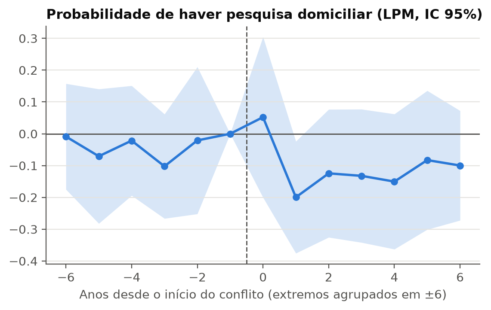
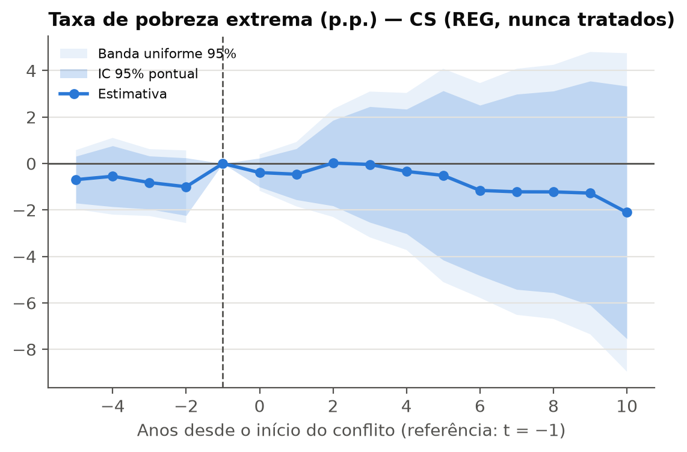
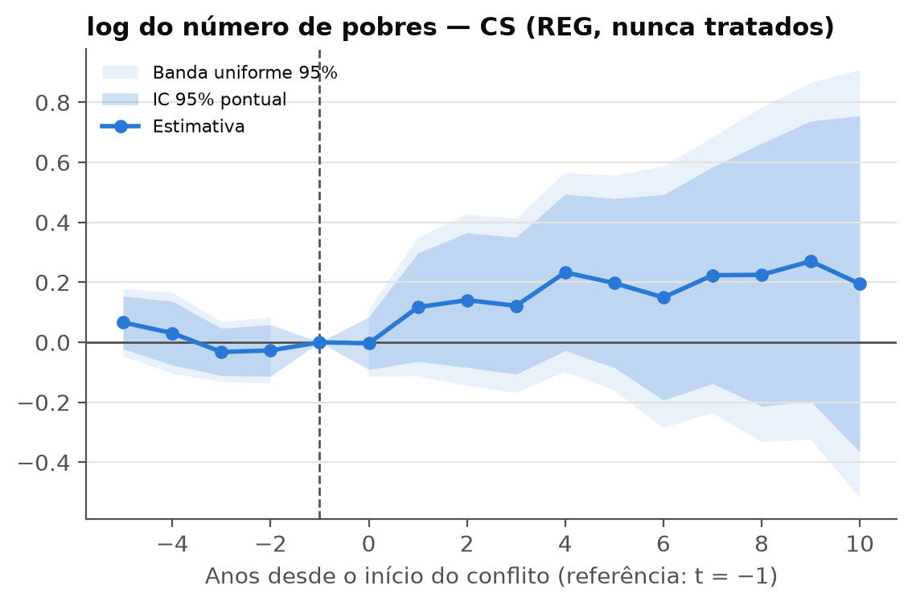
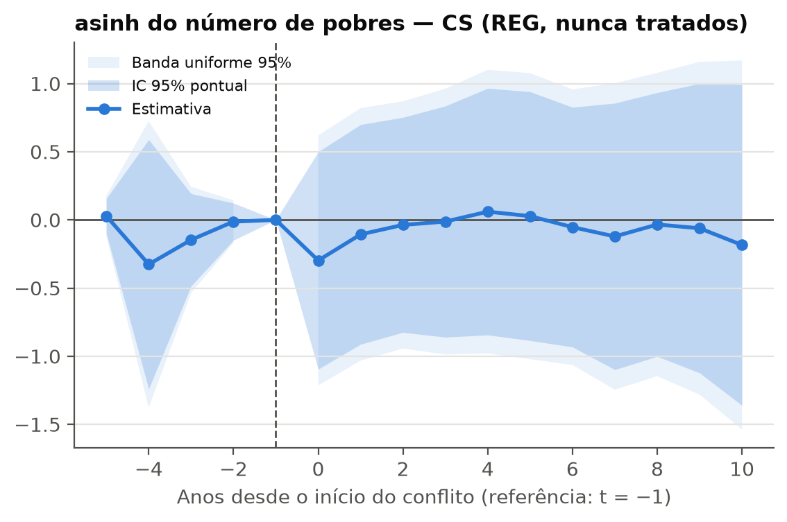
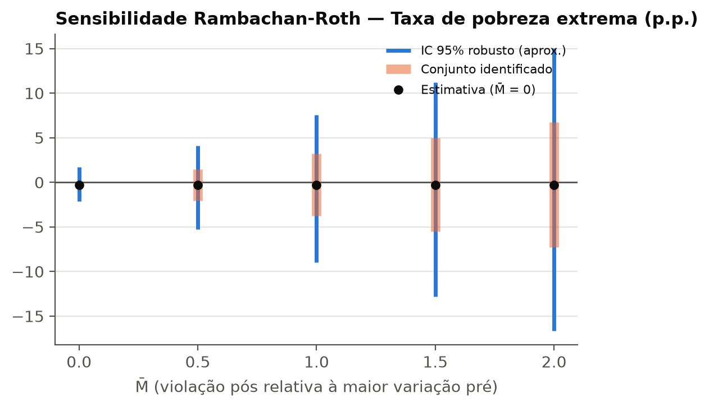

# Conflitos armados e pobreza: diferenças em diferenças com adoção escalonada

*Relatório gerado automaticamente por `src/09_report.py` a partir de `outputs/`. Amostra 1990–2024; linha de pobreza extrema US$ 3,00/dia (PPC 2021).*

## Resumo

- **Amostra de estimação:** 33 países com início de conflito (onset) após ≥ 5 anos de paz e 101 países nunca tratados; 83 países excluídos (ver §2). Há 20 coortes (1992–2022), com no máximo 3 países cada.
- **Taxa de pobreza:** o estimador principal (Callaway–Sant'Anna, regressão de resultado, nunca tratados) dá ATT = -0,73 p.p. (IC 95% [-3,44; 1,97]; não significativo). O TWFE convencional dá -8,36 p.p.; a diferença vem principalmente de tendências pré-tratamento divergentes (§4).
- **Número de pobres:** ATT em log = 0,16 (IC [-0,10; 0,42]; não significativo; 26 tratados sem zeros); em asinh = -0,07 (IC [-0,93; 0,78]); crescimento anual (Δlog) = 0,05 (IC [-0,06; 0,16]).
- **Dados faltantes:** o conflito reduz a probabilidade de haver pesquisa domiciliar em 8,2 p.p. (EP 4,1; p = 0,045). Nos anos de conflito, boa parte da série de pobreza é interpolada ou extrapolada por modelo (§3).
- **Conclusão:** com 33 episódios (3 com ≥ 1.000 mortes no 1º ano), os dados **não permitem rejeitar efeito nulo** do onset de conflito sobre a pobreza extrema (taxa e número) nos 10 anos seguintes na especificação principal. Os intervalos de confiança são largos e a sensibilidade a violações de tendências paralelas é alta (§5).

## 1. Fontes e versões

Copiado de `data/raw/MANIFEST.csv` (hash SHA-256 completo no arquivo).

| arquivo | fonte | versao | data_download | sha256 | licenca_termos |
|---|---|---|---|---|---|
| pip_versions_2026-10-15.json | PIP | 20260922_2021_01_02_PROD | 2026-10-15 | 804ea2f26f26… | CC BY 4.0 (World Bank Open Data terms) |
| pip_aux_poverty_lines_20260922_2021_01_02_PROD.csv | PIP | 20260922_2021_01_02_PROD | 2026-10-15 | dff15b810a19… | CC BY 4.0 (World Bank Open Data terms) |
| pip_survey_3.00_20260922_2021_01_02_PROD.csv | PIP | 20260922_2021_01_02_PROD | 2026-10-15 | d1147750f873… | CC BY 4.0 (World Bank Open Data terms) |
| pip_lineup_3.00_20260922_2021_01_02_PROD.csv | PIP | 20260922_2021_01_02_PROD | 2026-10-15 | d180d3e52855… | CC BY 4.0 (World Bank Open Data terms) |
| pip_survey_4.20_20260922_2021_01_02_PROD.csv | PIP | 20260922_2021_01_02_PROD | 2026-10-15 | fbb9f1c7cff5… | CC BY 4.0 (World Bank Open Data terms) |
| pip_lineup_4.20_20260922_2021_01_02_PROD.csv | PIP | 20260922_2021_01_02_PROD | 2026-10-15 | 6300ac50f6d6… | CC BY 4.0 (World Bank Open Data terms) |
| pip_survey_8.30_20260922_2021_01_02_PROD.csv | PIP | 20260922_2021_01_02_PROD | 2026-10-15 | 28390480af2f… | CC BY 4.0 (World Bank Open Data terms) |
| pip_lineup_8.30_20260922_2021_01_02_PROD.csv | PIP | 20260922_2021_01_02_PROD | 2026-10-15 | 504395510661… | CC BY 4.0 (World Bank Open Data terms) |
| ucdp-prio-acd-261-csv.zip | UCDP | 26.1 | 2026-10-15 | 5f9517432229… | CC BY 4.0 — citar UCDP e artigos de referência |
| ucdp-brd-conf-261-csv.zip | UCDP | 26.1 | 2026-10-15 | a88c81fb727f… | CC BY 4.0 — citar UCDP e artigos de referência |
| ged261-csv.zip | UCDP | 26.1 | 2026-10-15 | 8c941d84954e… | CC BY 4.0 — citar UCDP e artigos de referência |
| organizedviolencecy-261-csv.zip | UCDP | 26.1 | 2026-10-15 | 66910888f565… | CC BY 4.0 — citar UCDP e artigos de referência |
| wdi_controls.csv | WDI | lastupdated=2026-10-08 | 2026-10-15 | 05a71728e96e… | CC BY 4.0 (World Bank Open Data terms) |
| wgi_governance.csv | WGI | lastupdated=2026-09-25 | 2026-10-15 | 017661bf19cd… | CC BY 4.0 (World Bank Open Data terms) |
| OGHIST_2026_10_08.xlsx | WB-CLASS | 2026_10_08 | 2026-10-15 | a4024eb80521… | CC BY 4.0 (World Bank Open Data terms) |
| unhcr_population_by_coa.zip | UNHCR | API v1 (2026-10-15) | 2026-10-15 | 76bc4de60a3f… | UNHCR Refugee Data Finder — CC BY 4.0 IGO |
| unhcr_population_by_coo.zip | UNHCR | API v1 (2026-10-15) | 2026-10-15 | c52ee0a6009c… | UNHCR Refugee Data Finder — CC BY 4.0 IGO |
| DirectContiguity320.zip | COW | 3.2 | 2026-10-15 | f1be081934f3… | Correlates of War — uso livre com citação |

URLs exatas no MANIFEST. A linha de US$ 3,00 é a linha padrão (`is_default`) da versão PIP `20260922_2021_01_02_PROD` (`pip_aux_poverty_lines_*.csv`); US$ 4,20 e US$ 8,30 são as linhas superiores visíveis. UCDP versão 26.1.

Bases previstas no CLAUDE.md e **não usadas** nesta rodada (decisão do usuário): Penn World Table, V-Dem/Polity, Global MPI, ACLED, EM-DAT, IDMC, COW guerras. O regime político pré-conflito usa o WGI *Voice and Accountability* no lugar do V-Dem.

## 2. Construção da amostra e decisões

### 2.1 Pobreza (PIP)

- **reporting_level:** apenas 'national'; países sem série nacional excluídos: ['ARG']
- **nowcast:** anos nowcast excluídos: [2025, 2026]; fim da amostra = 2024
- **welfare_type_lineup:** 47 países mudam renda/consumo na série lineup (regra do PIP mantida)
- **welfare_type_survey:** série observada: welfare_type com mais anos por país (empate -> consumo)
- **zeros:** 448 país-anos com n_poor == 0 (ln indefinido; usar asinh_n_poor)
- Série principal: *lineup* (`fill_gaps=true`). `flag_observed_survey = 1` quando há pesquisa nacional na série `fill_gaps=false` no mesmo país-ano. O Gini não é publicado na série lineup e só existe nos anos de pesquisa.
- `n_poor = headcount × população (reporting_pop do PIP)`; `ln_n_poor` não é definido quando o número de pobres é zero. Por isso o `asinh_n_poor` é reportado como variável que preserva o painel completo.

### 2.2 Conflito (UCDP) e harmonização

- Conflito atribuído ao país de localização (`gwno_loc`); conflitos com várias localizações contam para cada uma. Conversão GW→ISO3 com `country_converter` + tabela manual (Alemanha, Iugoslávia/Sérvia, Kosovo, URSS/Rússia, Sudão/Sudão do Sul, Etiópia/Eritreia, Iêmen, Vietnã, Tchecoslováquia). Não casados: Vatican City State (`unmatched_codes.csv`).
- **Regra territorial (decisão do usuário):** a partir de 1989, um conflito interestatal só conta para um país se houve mortes interestatais no seu território (UCDP Country-Year). 27 localizações conflito-ano foram descartadas (11 países: AUS, CHN, ERI, ETH, GBR, IRN, IRQ, ISR, NGA, PAK, USA); por exemplo, a Austrália na guerra do Iraque de 2003. Sem a regra, a Austrália seria tratada em 2003.
- Mortes (`brd`, `brd_pc`) vêm do *UCDP Country-Year Dataset on Organized Violence within Country Borders* (agregação geográfica do GED, 1989+), e não da divisão do BRD entre localizações.

### 2.3 Definição do tratamento

- Coorte `g` = 1º ano com conflito (≥ 25 mortes) após ≥ 5 anos consecutivos sem conflito, com g ∈ [1991, 2024] e ≥ 3 anos de pesquisa de pobreza observada antes de g. Uma coorte por país.
- Nunca tratados: nenhum ano de conflito em [1985, 2024]. Não há restrição por grupo de renda (decisão do usuário): países de renda média e alta entram quando o conflito ocorre no seu território (ex.: Ucrânia, 2014).
- Reincidência mantida (decisão do usuário): um país com conflito antes da janela de paz pode ser tratado. 18 dos 33 tratados tiveram conflito em [1985, g); a heterogeneidade por onset limpo × reincidência está no §5.
- **Israel** fica excluído como "sempre tratado": está em conflito contínuo no período e nunca completa a janela de paz.

**Contagem por definição** (`treatment_variants_counts.csv`):

| status | g (PW=5) | g_pw3 | g_pw10 | g_war |
|---|---|---|---|---|
| excluido | 83 | 79 | 94 | 101 |
| nunca_tratado | 101 | 101 | 98 | 101 |
| tratado | 33 | 37 | 25 | 15 |

**Excluídos por motivo** (`excluded_countries.csv`):

| motivo | n | paises |
|---|---|---|
| onset(s) sem 3 anos de pobreza observada antes | 29 | AGO BIH CAF COD COG COM DJI DZA ECU ERI GIN GNB HRV HTI IRQ KHM LBN LBR LBY LSO MDA MKD NPL RWA SLE SRB SSD UZB YEM |
| sem código no sistema GW/UCDP (território não soberano) | 23 | ABW ASM BMU CHI CUW CYM FRO GIB GRL GUM HKG IMN MAC MAF MNP NCL PRI PSE PYF SXM TCA VGB VIR |
| sempre tratado: em conflito no início da amostra, sem janela de paz posterior | 31 | AFG COL ESP ETH GTM IND IRN ISR KWT LAO LKA MAR MMR NIC PAK PAN PHL PNG PRY ROU RUS SDN SLV SOM SUR TCD TTO TUR UGA VNM ZAF |

**Coortes** (`cohorts.csv`):

| g | iso3 | region_code | onset_type | onset_war | mortes/100 mil (média 3 anos) | duração 1º episódio | onset_clean |
|---|---|---|---|---|---|---|---|
| 1992 | VEN | LCN | intraestatal | 0 | 0,23 | 1 | 1 |
| 1994 | MEX | LCN | intraestatal | 0 | 0,07 | 1 | 1 |
| 1998 | GBR | ECS | intraestatal | 0 | 0,02 | 1 | 0 |
| 2001 | USA | NAC | intraestatal | 1 | 0,03 | 17 | 1 |
| 2002 | CIV | SSF | intraestatal | 0 | 1,53 | 3 | 1 |
| 2003 | THA | EAS | intraestatal | 0 | 0,20 | 23 | 0 |
| 2004 | GEO | ECS | intraestatal | 0 | 0,23 | 1 | 0 |
| 2004 | NGA | SSF | intraestatal | 0 | 0,04 | 1 | 1 |
| 2005 | AZE | ECS | intraestatal | 0 | 0,16 | 1 | 0 |
| 2005 | BGD | SAS | intraestatal | 0 | 0,04 | 2 | 0 |
| 2007 | MLI | SSF | intraestatal | 0 | 0,61 | 3 | 0 |
| 2007 | NER | SSF | intraestatal | 0 | 0,28 | 2 | 0 |
| 2007 | PER | LCN | intraestatal | 0 | 0,14 | 4 | 0 |
| 2008 | CHN | EAS | intraestatal | 0 | 0,00 | 1 | 0 |
| 2010 | MRT | SSF | intraestatal | 0 | 0,12 | 1 | 1 |
| 2010 | TJK | ECS | intraestatal | 0 | 0,55 | 2 | 0 |
| 2011 | SEN | SSF | intraestatal | 0 | 0,12 | 1 | 0 |
| 2011 | SYR | MEA | intraestatal | 1 | 186,48 | 15 | 1 |
| 2013 | MOZ | SSF | intraestatal | 0 | 0,09 | 2 | 0 |
| 2013 | MYS | EAS | intraestatal | 0 | 0,08 | 1 | 1 |
| 2013 | TUN | MEA | intraestatal | 0 | 0,46 | 4 | 1 |
| 2014 | BDI | SSF | intraestatal | 0 | 0,77 | 2 | 0 |
| 2014 | EGY | MEA | intraestatal | 0 | 0,45 | 9 | 0 |
| 2014 | UKR | ECS | intraestatal | 1 | 5,44 | 12 | 1 |
| 2015 | CMR | SSF | intraestatal | 0 | 1,78 | 11 | 0 |
| 2015 | KEN | SSF | intraestatal | 0 | 0,13 | 11 | 1 |
| 2016 | JOR | MEA | intraestatal | 0 | 0,11 | 1 | 1 |
| 2018 | BFA | SSF | intraestatal | 0 | 1,51 | 8 | 0 |
| 2018 | IDN | EAS | intraestatal | 0 | 0,01 | 8 | 0 |
| 2020 | TZA | SSF | intraestatal | 0 | 0,02 | 1 | 1 |
| 2021 | KGZ | ECS | interestatal | 0 | 0,50 | 2 | 1 |
| 2022 | BEN | SSF | intraestatal | 0 | 0,32 | 4 | 1 |
| 2022 | TGO | SSF | intraestatal | 0 | 0,39 | 4 | 0 |

### 2.4 Balanço pré-tratamento

Médias por país em g−5…g−1 (tratados) e na amostra toda (nunca tratados); teste t de Welch (`pretreatment_balance.csv`).

| variavel | media_tratados | n_tratados | media_nunca_tratados | n_nunca_tratados | diferenca | p_valor |
|---|---|---|---|---|---|---|
| pov_rate | 29,108 | 33 | 10,619 | 101 | 18,489 | 0,000 |
| ln_n_poor | 14,810 | 33 | 10,175 | 99 | 4,634 | 0,000 |
| mean | 10,815 | 33 | 29,647 | 101 | -18,832 | 0,000 |
| ln_gdppc | 8,690 | 32 | 9,802 | 96 | -1,112 | 0,000 |
| urban_share | 47,832 | 33 | 61,683 | 100 | -13,851 | 0,002 |
| ln_pop | 17,124 | 33 | 14,404 | 101 | 2,720 | 0,000 |
| trade_gdp | 64,822 | 30 | 102,234 | 88 | -37,412 | 0,000 |
| flag_observed_survey | 0,420 | 33 | 0,322 | 101 | 0,098 | 0,164 |
| wgi_va | -0,431 | 31 | 0,428 | 100 | -0,859 | 0,000 |

Tratados e controles diferem muito em nível (pobreza, renda, população, abertura). O DiD exige tendências paralelas, não níveis iguais, mas a diferença de nível torna a hipótese de tendências comuns menos plausível. Por isso a especificação principal condiciona em PIB per capita, urbanização e população pré-tratamento.

## 3. Diagnóstico crítico: dados faltantes

> **Este diagnóstico condiciona a interpretação de todos os resultados.**

- Proporção de anos com pesquisa observada (`missing_survey_prepost.csv`): tratados 42,0% nos 5 anos antes do onset e 39,4% nos 6 anos a partir dele; controles, nos mesmos anos-calendário, 36,6% e 39,6%.
- Regressão de probabilidade linear `flag_observed_survey ~ pós-onset | país + ano` (EP cluster país): **-0,082** (EP 0,041; p = 0,045). O conflito reduz a frequência de pesquisas.
- Composição do dado de pobreza nos tratados (`estimation_type_by_period.csv`): antes do onset, CMD estimation 0,0%; extrapolation 16,7%; interpolation 58,4%; survey 24,8%; depois, CMD estimation 2,0%; extrapolation 20,5%; interpolation 40,0%; survey 37,6%.
- Consequência: nos anos de conflito, a série lineup é em boa parte interpolada entre pesquisas ou extrapolada com o crescimento do PIB/consumo das contas nacionais. Um efeito estimado na série lineup pode refletir o modelo de extrapolação do PIP (choque de PIB × elasticidade neutra em distribuição), e não pobreza medida. Um efeito nulo pode refletir pesquisas que não chegam às áreas afetadas. A checagem com dados só observados está no §5.

## 4. Resultados principais

ATT agregado (`main_results.csv`). "simple" = média ponderada das ATT(g,t) pós-onset (e ∈ [0,10]), com pesos proporcionais ao tamanho da coorte, como `did::aggte(type="simple")`. EP de bootstrap multiplicador com cluster por país.

**Taxa de pobreza extrema (p.p.)**

| estimator | estimate | se | ci_low | ci_high | p_value | n_treated |
|---|---|---|---|---|---|---|
| TWFE | -8,356 | 2,773 | -13,841 | -2,870 | 0,003 | 33 |
| CS (REG, nunca tratados) — simple | -0,734 | 1,380 | -3,438 | 1,971 | 0,595 | 32 |
| CS (REG, ainda não tratados) — simple | 0,186 | 1,247 | -2,259 | 2,631 | 0,881 | 32 |
| CS (sem covariáveis, nunca tratados) — simple | -1,538 | 1,293 | -4,072 | 0,995 | 0,234 | 33 |
| CS (DR c/ fallback REG, nunca tratados) — simple | -2,345 | 1,493 | -5,271 | 0,581 | 0,116 | 32 |
| Sun-Abraham (IW) — média e∈[0,9] | -1,433 | 0,914 | -3,240 | 0,374 | 0,119 | 33 |
| Borusyak-Jaravel-Spiess (did2s) — estático | -6,146 | 2,508 | -11,063 | -1,230 | 0,014 | 33 |
| de Chaisemartin-D'Haultfœuille DID_M (não absorvente) | 0,208 | 0,156 | -0,098 | 0,515 | 0,183 | — |

**log do número de pobres**

| estimator | estimate | se | ci_low | ci_high | p_value | n_treated |
|---|---|---|---|---|---|---|
| TWFE | 0,095 | 0,267 | -0,433 | 0,623 | 0,723 | 33 |
| CS (REG, nunca tratados) — simple | 0,164 | 0,133 | -0,097 | 0,424 | 0,218 | 26 |
| CS (REG, ainda não tratados) — simple | 0,143 | 0,116 | -0,084 | 0,369 | 0,217 | 26 |
| CS (sem covariáveis, nunca tratados) — simple | 0,151 | 0,108 | -0,060 | 0,362 | 0,160 | 27 |
| CS (DR c/ fallback REG, nunca tratados) — simple | -0,010 | 0,098 | -0,202 | 0,183 | 0,921 | 26 |
| Sun-Abraham (IW) — média e∈[0,9] | 0,278 | 0,146 | -0,010 | 0,566 | 0,058 | 33 |
| Borusyak-Jaravel-Spiess (did2s) — estático | 0,123 | 0,249 | -0,365 | 0,611 | 0,622 | 33 |
| de Chaisemartin-D'Haultfœuille DID_M (não absorvente) | 0,055 | 0,019 | 0,017 | 0,093 | 0,004 | — |

**asinh do número de pobres**

| estimator | estimate | se | ci_low | ci_high | p_value | n_treated |
|---|---|---|---|---|---|---|
| TWFE | -0,570 | 0,642 | -1,841 | 0,701 | 0,376 | 33 |
| CS (REG, nunca tratados) — simple | -0,075 | 0,438 | -0,933 | 0,784 | 0,865 | 32 |
| CS (REG, ainda não tratados) — simple | -0,078 | 0,448 | -0,956 | 0,801 | 0,863 | 32 |
| CS (sem covariáveis, nunca tratados) — simple | -0,089 | 0,389 | -0,852 | 0,675 | 0,820 | 33 |
| CS (DR c/ fallback REG, nunca tratados) — simple | -0,266 | 0,465 | -1,177 | 0,644 | 0,566 | 32 |
| Sun-Abraham (IW) — média e∈[0,9] | -0,075 | 0,258 | -0,586 | 0,435 | 0,771 | 33 |
| Borusyak-Jaravel-Spiess (did2s) — estático | -0,292 | 0,532 | -1,335 | 0,752 | 0,584 | 33 |
| de Chaisemartin-D'Haultfœuille DID_M (não absorvente) | 0,052 | 0,055 | -0,055 | 0,160 | 0,342 | — |

**Crescimento anual do número de pobres (Δlog)**

| estimator | estimate | se | ci_low | ci_high | p_value | n_treated |
|---|---|---|---|---|---|---|
| TWFE | -0,004 | 0,031 | -0,066 | 0,057 | 0,895 | 33 |
| CS (REG, nunca tratados) — simple | 0,052 | 0,057 | -0,059 | 0,163 | 0,360 | 26 |
| CS (REG, ainda não tratados) — simple | 0,052 | 0,058 | -0,063 | 0,166 | 0,378 | 26 |
| CS (sem covariáveis, nunca tratados) — simple | 0,044 | 0,058 | -0,069 | 0,157 | 0,442 | 27 |
| CS (DR c/ fallback REG, nunca tratados) — simple | 0,036 | 0,057 | -0,076 | 0,149 | 0,530 | 26 |
| Sun-Abraham (IW) — média e∈[0,9] | 0,071 | 0,039 | -0,005 | 0,148 | 0,067 | 33 |
| Borusyak-Jaravel-Spiess (did2s) — estático | 0,011 | 0,032 | -0,052 | 0,074 | 0,735 | 33 |
| de Chaisemartin-D'Haultfœuille DID_M (não absorvente) | 0,040 | 0,029 | -0,017 | 0,097 | 0,166 | — |

**Pré-tendências** (Wald conjunto dos coeficientes e ∈ [−5, −2], base variável; `pretrend_tests.csv`):

| outcome | estimator | wald | df | p_value |
|---|---|---|---|---|
| pov_rate | CS (REG, nunca tratados) | 7,519 | 4 | 0,111 |
| pov_rate | CS (REG, ainda não tratados) | 5,579 | 4 | 0,233 |
| pov_rate | CS (sem covariáveis, nunca tratados) | 15,654 | 4 | 0,004 |
| pov_rate | CS (DR c/ fallback REG, nunca tratados) | 14,278 | 4 | 0,006 |
| ln_n_poor | CS (REG, nunca tratados) | 5,613 | 4 | 0,230 |
| ln_n_poor | CS (REG, ainda não tratados) | 5,341 | 4 | 0,254 |
| ln_n_poor | CS (sem covariáveis, nunca tratados) | 5,004 | 4 | 0,287 |
| ln_n_poor | CS (DR c/ fallback REG, nunca tratados) | 7,061 | 4 | 0,133 |
| asinh_n_poor | CS (REG, nunca tratados) | 2,783 | 4 | 0,595 |
| asinh_n_poor | CS (REG, ainda não tratados) | 3,135 | 4 | 0,536 |
| asinh_n_poor | CS (sem covariáveis, nunca tratados) | 3,546 | 4 | 0,471 |
| asinh_n_poor | CS (DR c/ fallback REG, nunca tratados) | 4,270 | 4 | 0,371 |
| d_ln_n_poor | CS (REG, nunca tratados) | 3,965 | 4 | 0,411 |
| d_ln_n_poor | CS (REG, ainda não tratados) | 3,828 | 4 | 0,430 |
| d_ln_n_poor | CS (sem covariáveis, nunca tratados) | 3,939 | 4 | 0,414 |
| d_ln_n_poor | CS (DR c/ fallback REG, nunca tratados) | 3,810 | 4 | 0,432 |

**Goodman-Bacon** (`bacon_decomposition.csv`): na taxa de pobreza, o TWFE (painel balanceado) = -8,36 p.p.; peso das comparações "proibidas" (tratados tardios contra já tratados) = 0,05; peso de tratado × nunca tratado = 0,89. O viés do TWFE aqui não vem das comparações proibidas. Ele vem de comparações tratado × nunca tratado sob tendências divergentes, as mesmas que fazem o CS sem covariáveis rejeitar tendências paralelas.

**Leitura.** Na taxa de pobreza, sem covariáveis, o teste de pré-tendências contra os nunca tratados tem p = 0,004: os tratados reduziam a pobreza mais rápido já antes do onset (convergência a partir de níveis altos; ver `raw_means_pov_rate.png`). O TWFE e a imputação BJS, que usam todo o período pré como referência, transformam essa tendência num efeito negativo grande (-8,36 e -6,15 p.p.). Com covariáveis pré (REG; pré-tendência p = 0,111) ou com controles ainda não tratados (p = 0,233), o ATT fica em -0,73 e 0,19 p.p. O DR não se sustenta com coortes de 1 a 3 países: há separação perfeita no propensity score e a estimação recai em REG em 330 células (g, t) (`main_results.csv`, coluna nota). Por isso a especificação principal com covariáveis é a regressão de resultado.

**DID_M (não absorvente).** Para o log do número de pobres, o DID_M é 0,055 (p = 0,004); placebo = 0,023 (EP 0,017); 310 trocas. Ele usa todas as entradas e saídas de conflito (192 países, inclusive os excluídos do desenho principal) e mede o efeito contemporâneo de estar em conflito no ano da troca. Por isso não é diretamente comparável ao ATT de onset. Sugere um aumento pequeno no número de pobres no ano de entrada em conflito; o placebo (a mesma comparação um ano antes) não é significativo, mas é positivo.

Figuras (IC 95% pontual e banda uniforme; linha vertical em t = −1):

Comparação: `event_study_{outcome}_{cs_notyet_reg, cs_never_unc, cs_never_dr, sunab, bjs, twfe}.png` e `raw_means_{pov_rate,ln_n_poor}.png` em `outputs/figures/`.

**Dose-resposta** (CS REG por tercil de mortes em combate por 100 mil hab. nos 3 primeiros anos; `dose_response.csv`):

| outcome | tercil | brd_pc_min | brd_pc_max | n_treated | estimate | se | ci_low | ci_high | p_value |
|---|---|---|---|---|---|---|---|---|---|
| pov_rate | 1 | 0,001 | 0,1 | 11 | -1,166 | 1,932 | -4,953 | 2,620 | 0,546 |
| pov_rate | 2 | 0,121 | 0,4 | 10 | -2,655 | 2,414 | -7,386 | 2,077 | 0,271 |
| pov_rate | 3 | 0,448 | 186,5 | 11 | 1,338 | 2,298 | -3,167 | 5,842 | 0,561 |
| ln_n_poor | 1 | 0,001 | 0,1 | 8 | 0,400 | 0,148 | 0,110 | 0,690 | 0,007 |
| ln_n_poor | 2 | 0,121 | 0,4 | 9 | -0,054 | 0,200 | -0,445 | 0,338 | 0,789 |
| ln_n_poor | 3 | 0,448 | 186,5 | 9 | 0,156 | 0,187 | -0,210 | 0,522 | 0,403 |
| asinh_n_poor | 1 | 0,001 | 0,1 | 11 | -0,114 | 0,344 | -0,789 | 0,560 | 0,740 |
| asinh_n_poor | 2 | 0,121 | 0,4 | 10 | -0,977 | 1,315 | -3,554 | 1,601 | 0,458 |
| asinh_n_poor | 3 | 0,448 | 186,5 | 11 | 0,734 | 0,593 | -0,429 | 1,897 | 0,216 |

Não há gradiente monotônico de dose-resposta. O tercil superior mistura conflitos de intensidade muito diferente (até 186 mortes por 100 mil hab./ano).

## 5. Robustez

Tabela completa em `robustness.csv` / `.tex`.

| teste | outcome | estimate | se | ci_low | ci_high | p_value | n_treated |
|---|---|---|---|---|---|---|---|
| Referência: CS REG, nunca tratados | pov_rate | -0,734 | 1,380 | -3,438 | 1,971 | 0,595 | 32 |
| Referência: CS REG, nunca tratados | ln_n_poor | 0,164 | 0,133 | -0,097 | 0,424 | 0,218 | 26 |
| Referência: CS REG, nunca tratados | asinh_n_poor | -0,075 | 0,438 | -0,933 | 0,784 | 0,865 | 32 |
| Somente pesquisas observadas, blocos de 3 anos (CS sem X, desbalanceado) | pov_rate | -3,853 | 1,527 | -6,846 | -0,861 | 0,012 | 33 |
| Somente pesquisas observadas, blocos de 3 anos (CS sem X, desbalanceado) | ln_n_poor | -0,191 | 0,123 | -0,433 | 0,051 | 0,121 | 33 |
| PEACE_WINDOW = 3 (CS sem X) | pov_rate | -1,833 | 1,174 | -4,134 | 0,469 | 0,119 | 37 |
| PEACE_WINDOW = 3 (CS sem X) | ln_n_poor | 0,150 | 0,098 | -0,042 | 0,341 | 0,126 | 31 |
| PEACE_WINDOW = 3 (CS sem X) | asinh_n_poor | -0,053 | 0,385 | -0,807 | 0,702 | 0,891 | 37 |
| PEACE_WINDOW = 10 (CS sem X) | pov_rate | -0,942 | 1,314 | -3,517 | 1,632 | 0,473 | 25 |
| PEACE_WINDOW = 10 (CS sem X) | ln_n_poor | 0,122 | 0,134 | -0,140 | 0,384 | 0,362 | 20 |
| PEACE_WINDOW = 10 (CS sem X) | asinh_n_poor | 0,218 | 0,305 | -0,379 | 0,815 | 0,474 | 25 |
| Onset por guerra (≥ 1.000 mortes) (CS sem X) | pov_rate | -0,111 | 1,795 | -3,630 | 3,408 | 0,951 | 15 |
| Onset por guerra (≥ 1.000 mortes) (CS sem X) | ln_n_poor | 0,192 | 0,122 | -0,048 | 0,431 | 0,117 | 13 |
| Onset por guerra (≥ 1.000 mortes) (CS sem X) | asinh_n_poor | 0,612 | 0,501 | -0,370 | 1,594 | 0,222 | 15 |
| Controles sem vizinhos de tratados e sem grandes receptores de refugiados | pov_rate | -1,187 | 1,500 | -4,127 | 1,754 | 0,429 | 32 |
| Controles sem vizinhos de tratados e sem grandes receptores de refugiados | ln_n_poor | 0,165 | 0,145 | -0,119 | 0,449 | 0,254 | 26 |
| Controles sem vizinhos de tratados e sem grandes receptores de refugiados | asinh_n_poor | -0,049 | 0,445 | -0,923 | 0,824 | 0,912 | 32 |
| Efeito sobre vizinhos de tratados (vizinho = tratado; controles não vizinhos) | pov_rate | -1,668 | 1,289 | -4,194 | 0,858 | 0,196 | 28 |
| Efeito sobre vizinhos de tratados (vizinho = tratado; controles não vizinhos) | ln_n_poor | -0,141 | 0,176 | -0,485 | 0,204 | 0,423 | 22 |
| Efeito sobre vizinhos de tratados (vizinho = tratado; controles não vizinhos) | asinh_n_poor | -0,433 | 0,368 | -1,155 | 0,288 | 0,239 | 28 |
| Antecipação = 1 | pov_rate | -1,019 | 1,552 | -4,061 | 2,023 | 0,511 | 32 |
| Antecipação = 1 | ln_n_poor | 0,128 | 0,163 | -0,191 | 0,448 | 0,431 | 26 |
| Antecipação = 1 | asinh_n_poor | 0,293 | 0,792 | -1,259 | 1,845 | 0,711 | 32 |
| Antecipação = 2 | pov_rate | -1,977 | 1,824 | -5,551 | 1,598 | 0,278 | 32 |
| Antecipação = 2 | ln_n_poor | 0,099 | 0,176 | -0,246 | 0,444 | 0,575 | 26 |
| Antecipação = 2 | asinh_n_poor | 0,285 | 0,817 | -1,316 | 1,886 | 0,727 | 32 |
| Synthetic DiD — coorte 2007 | pov_rate | -9,859 | 2,773 | -15,294 | -4,424 | 0,000 | 3 |
| Synthetic DiD — coorte 2007 | ln_n_poor | -0,110 | 0,341 | -0,778 | 0,558 | 0,747 | 3 |
| Synthetic DiD — coorte 2007 | asinh_n_poor | 0,307 | 0,872 | -1,403 | 2,016 | 0,725 | 3 |
| Synthetic DiD — coorte 2013 | pov_rate | 1,166 | 1,590 | -1,950 | 4,282 | 0,463 | 3 |
| Synthetic DiD — coorte 2013 | ln_n_poor | -0,677 | 0,266 | -1,198 | -0,156 | 0,011 | 3 |
| Synthetic DiD — coorte 2013 | asinh_n_poor | -1,073 | 1,091 | -3,212 | 1,066 | 0,325 | 3 |
| Synthetic DiD — coorte 2014 | pov_rate | -0,206 | 1,463 | -3,074 | 2,661 | 0,888 | 3 |
| Synthetic DiD — coorte 2014 | ln_n_poor | 0,270 | 0,423 | -0,559 | 1,098 | 0,524 | 2 |
| Synthetic DiD — coorte 2014 | asinh_n_poor | 0,462 | 0,901 | -1,304 | 2,229 | 0,608 | 3 |

**Checagens com IC 95% que exclui zero:** Somente pesquisas observadas, blocos de 3 anos (CS sem X, desbalanceado) / pov_rate: -3,85 (p = 0,012, 33 tratados); Synthetic DiD — coorte 2007 / pov_rate: -9,86 (p = 0,000, 3 tratados); Synthetic DiD — coorte 2013 / ln_n_poor: -0,68 (p = 0,011, 3 tratados).

- *Somente pesquisas observadas* (-3,85 p.p., p = 0,012) é a checagem mais importante para o problema do §3. Ela usa só anos com pesquisa, agregados em blocos de 3 anos, sem covariáveis. Seu sinal acompanha o das especificações sem covariáveis na série lineup, cujo teste de pré-tendências rejeita (p = 0,004). A leitura mais cautelosa é que o resultado reproduz a convergência pré-onset dos tratados, não um efeito do conflito. Em todo caso, ele não indica aumento da pobreza medida por pesquisas após o conflito.
- As estimativas SDID se apoiam numa única coorte de poucos países cada; resultados isolados por coorte não contrariam o ATT agregado, dado o número de comparações.

| teste | estimate | se | ci_low | ci_high | p_value | n_treated |
|---|---|---|---|---|---|---|
| Linha US$ 4,20 — taxa | 0,083 | 1,618 | -3,088 | 3,255 | 0,959 | 32 |
| Linha US$ 4,20 — log nº pobres | 0,201 | 0,131 | -0,056 | 0,459 | 0,126 | 30 |
| Linha US$ 8,30 — taxa | 1,598 | 2,561 | -3,422 | 6,617 | 0,533 | 32 |
| Linha US$ 8,30 — log nº pobres | 0,076 | 0,121 | -0,161 | 0,313 | 0,527 | 32 |

### 5.1 Sensibilidade a violações de tendências paralelas (Rambachan & Roth)

CS REG com período-base universal. *Relative magnitudes*: a violação pós-onset entre anos consecutivos é limitada a M̄ × a maior variação pré (`mbar`). *SD(0)*: o viés segue a tendência linear pré extrapolada (`mbar` = inclinação). **Implementação própria**: conjunto identificado em forma fechada e IC por simulação de N(β̂, Σ̂). É uma aproximação ao teste condicional/híbrido do pacote `HonestDiD`, que não foi usado porque o R não está disponível (`honestdid_rm.csv`).

| outcome | alvo | M | estimativa | mbar | id_set_low | id_set_high | ci_low | ci_high |
|---|---|---|---|---|---|---|---|---|
| pov_rate | e = 0 | 0 | -0,390 | 1,000 | -0,390 | -0,390 | -0,984 | 0,220 |
| pov_rate | e = 0 | 0,5 | -0,390 | 1,000 | -0,890 | 0,110 | -1,891 | 0,888 |
| pov_rate | e = 0 | 1 | -0,390 | 1,000 | -1,390 | 0,609 | -2,944 | 1,859 |
| pov_rate | e = 0 | 1,5 | -0,390 | 1,000 | -1,890 | 1,109 | -3,989 | 2,908 |
| pov_rate | e = 0 | 2 | -0,390 | 1,000 | -2,389 | 1,609 | -5,086 | 3,995 |
| pov_rate | média e ∈ [0,5] | 0 | -0,288 | 1,000 | -0,288 | -0,288 | -2,136 | 1,684 |
| pov_rate | média e ∈ [0,5] | 0,5 | -0,288 | 1,000 | -2,037 | 1,462 | -5,264 | 4,091 |
| pov_rate | média e ∈ [0,5] | 1 | -0,288 | 1,000 | -3,786 | 3,211 | -8,958 | 7,550 |
| pov_rate | média e ∈ [0,5] | 1,5 | -0,288 | 1,000 | -5,536 | 4,960 | -12,794 | 11,193 |
| pov_rate | média e ∈ [0,5] | 2 | -0,288 | 1,000 | -7,285 | 6,710 | -16,626 | 15,053 |
| pov_rate | e = 0 | SD(0): tendência linear extrapolada | 0,296 | -0,686 | 0,296 | 0,296 | -0,305 | 0,901 |
| pov_rate | média e ∈ [0,5] | SD(0): tendência linear extrapolada | 2,115 | -0,686 | 2,115 | 2,115 | -0,014 | 4,273 |
| ln_n_poor | e = 0 | 0 | -0,003 | 0,035 | -0,003 | -0,003 | -0,090 | 0,083 |
| ln_n_poor | e = 0 | 0,5 | -0,003 | 0,035 | -0,021 | 0,014 | -0,141 | 0,136 |
| ln_n_poor | e = 0 | 1 | -0,003 | 0,035 | -0,038 | 0,031 | -0,199 | 0,199 |
| ln_n_poor | e = 0 | 1,5 | -0,003 | 0,035 | -0,055 | 0,048 | -0,262 | 0,270 |
| ln_n_poor | e = 0 | 2 | -0,003 | 0,035 | -0,073 | 0,066 | -0,331 | 0,345 |
| ln_n_poor | média e ∈ [0,5] | 0 | 0,134 | 0,035 | 0,134 | 0,134 | -0,061 | 0,325 |
| ln_n_poor | média e ∈ [0,5] | 0,5 | 0,134 | 0,035 | 0,074 | 0,195 | -0,249 | 0,496 |
| ln_n_poor | média e ∈ [0,5] | 1 | 0,134 | 0,035 | 0,013 | 0,255 | -0,477 | 0,726 |
| ln_n_poor | média e ∈ [0,5] | 1,5 | 0,134 | 0,035 | -0,047 | 0,316 | -0,726 | 0,985 |
| ln_n_poor | média e ∈ [0,5] | 2 | 0,134 | 0,035 | -0,108 | 0,376 | -0,991 | 1,247 |
| ln_n_poor | e = 0 | SD(0): tendência linear extrapolada | 0,014 | -0,017 | 0,014 | 0,014 | -0,061 | 0,087 |
| ln_n_poor | média e ∈ [0,5] | SD(0): tendência linear extrapolada | 0,194 | -0,017 | 0,194 | 0,194 | -0,031 | 0,416 |
| asinh_n_poor | e = 0 | 0 | -0,298 | 0,338 | -0,298 | -0,298 | -0,847 | 0,273 |
| asinh_n_poor | e = 0 | 0,5 | -0,298 | 0,338 | -0,467 | -0,128 | -1,127 | 0,591 |
| asinh_n_poor | e = 0 | 1 | -0,298 | 0,338 | -0,636 | 0,041 | -1,496 | 1,011 |
| asinh_n_poor | e = 0 | 1,5 | -0,298 | 0,338 | -0,805 | 0,210 | -1,922 | 1,485 |
| asinh_n_poor | e = 0 | 2 | -0,298 | 0,338 | -0,974 | 0,379 | -2,391 | 1,964 |
| asinh_n_poor | média e ∈ [0,5] | 0 | -0,061 | 0,338 | -0,061 | -0,061 | -0,726 | 0,624 |
| asinh_n_poor | média e ∈ [0,5] | 0,5 | -0,061 | 0,338 | -0,653 | 0,531 | -1,787 | 2,175 |
| asinh_n_poor | média e ∈ [0,5] | 1 | -0,061 | 0,338 | -1,245 | 1,123 | -3,417 | 3,940 |
| asinh_n_poor | média e ∈ [0,5] | 1,5 | -0,061 | 0,338 | -1,837 | 1,716 | -5,183 | 5,720 |
| asinh_n_poor | média e ∈ [0,5] | 2 | -0,061 | 0,338 | -2,429 | 2,308 | -6,931 | 7,491 |
| asinh_n_poor | e = 0 | SD(0): tendência linear extrapolada | -0,330 | 0,032 | -0,330 | -0,330 | -0,798 | 0,169 |
| asinh_n_poor | média e ∈ [0,5] | SD(0): tendência linear extrapolada | -0,174 | 0,032 | -0,174 | -0,174 | -0,597 | 0,267 |

Para a taxa de pobreza, extrapolar linearmente a tendência pré relativa (inclinação -0,69 p.p. por ano) leva o efeito médio em e ∈ [0,5] de -0,29 para 2,11 p.p. (IC -0,01; 4,27; inclui zero). Isso indicaria que o conflito **interrompeu uma queda da pobreza** que vinha ocorrendo. Sob *relative magnitudes*, o IC já inclui zero sem violação alguma (M̄ = 0). O resultado depende de hipóteses sobre a tendência contrafactual.

### 5.2 Placebo (500 permutações)

| outcome | att_sem_covariaveis | p_permutacao | placebo_media | placebo_dp | n_perm |
|---|---|---|---|---|---|
| pov_rate | -1,538 | 0,060 | 0,045 | 0,830 | 500 |
| ln_n_poor | 0,151 | 0,220 | -0,006 | 0,130 | 500 |
| asinh_n_poor | -0,089 | 0,778 | -0,007 | 0,323 | 500 |

ATT sem covariáveis contra a distribuição de ATT com datas de onset sorteadas entre os nunca tratados (`placebo_permutations.png`). O p-valor é a fração de placebos com |ATT| ≥ |ATT estimado|.

### 5.3 Synthetic DiD

| g | outcome | estimate | se | ci_low | ci_high | p_value | n_treated | n_controls | top_controls |
|---|---|---|---|---|---|---|---|---|---|
| 2007 | pov_rate | -9,859 | 2,773 | -15,294 | -4,424 | 0,000 | 3 | 101 | GNQ:0.07, MDG:0.04, MNG:0.03, ARM:0.03, POL:0.03 |
| 2007 | ln_n_poor | -0,110 | 0,341 | -0,778 | 0,558 | 0,747 | 3 | 77 | ITA:0.04, SWE:0.04, PRK:0.04, GAB:0.03, ZWE:0.03 |
| 2007 | asinh_n_poor | 0,307 | 0,872 | -1,403 | 2,016 | 0,725 | 3 | 101 | FIN:0.01, ISL:0.01, DNK:0.01, AUT:0.01, ZWE:0.01 |
| 2013 | pov_rate | 1,166 | 1,590 | -1,950 | 4,282 | 0,463 | 3 | 101 | TKM:0.02, LTU:0.02, ZWE:0.02, GHA:0.02, SLB:0.02 |
| 2013 | ln_n_poor | -0,677 | 0,266 | -1,198 | -0,156 | 0,011 | 3 | 76 | KAZ:0.06, BTN:0.04, MNG:0.04, XKX:0.04, CHL:0.03 |
| 2013 | asinh_n_poor | -1,073 | 1,091 | -3,212 | 1,066 | 0,325 | 3 | 101 | DNK:0.02, SGP:0.02, CYP:0.02, KAZ:0.01, BTN:0.01 |
| 2014 | pov_rate | -0,206 | 1,463 | -3,074 | 2,661 | 0,888 | 3 | 101 | XKX:0.04, TKM:0.04, PRK:0.04, TLS:0.04, MDG:0.03 |
| 2014 | ln_n_poor | 0,270 | 0,423 | -0,559 | 1,098 | 0,524 | 2 | 76 | KAZ:0.10, MNG:0.09, LCA:0.08, PRK:0.08, ARM:0.07 |
| 2014 | asinh_n_poor | 0,462 | 0,901 | -1,304 | 2,229 | 0,608 | 3 | 101 | TWN:0.03, SGP:0.03, DNK:0.03, NLD:0.02, URY:0.02 |

Coortes com o maior número de países (3 cada). EP pelo método placebo de Arkhangelsky et al. (2021), implementação própria validada em `tests/test_did_tools.py`. As estimativas variam muito entre coortes (taxa de pobreza: de -9,86 a 1,17 p.p.) e cada uma se apoia em poucos países.

### 5.4 Heterogeneidade

| grupo | outcome | n_treated | estimate | se | ci_low | ci_high | p_value |
|---|---|---|---|---|---|---|---|
| África Subsaariana | pov_rate | 14 | -2,319 | 2,182 | -6,597 | 1,958 | 0,288 |
| África Subsaariana | ln_n_poor | 14 | 0,273 | 0,139 | 0,001 | 0,545 | 0,049 |
| África Subsaariana | asinh_n_poor | 14 | 0,416 | 0,181 | 0,063 | 0,770 | 0,021 |
| Fora da África Subsaariana | pov_rate | 18 | 0,346 | 1,557 | -2,706 | 3,398 | 0,824 |
| Fora da África Subsaariana | ln_n_poor | 12 | 0,049 | 0,185 | -0,313 | 0,412 | 0,789 |
| Fora da África Subsaariana | asinh_n_poor | 18 | -0,409 | 0,718 | -1,816 | 0,998 | 0,569 |
| Renda baixa (pré) | pov_rate | 11 | -1,301 | 2,064 | -5,347 | 2,745 | 0,529 |
| Renda baixa (pré) | ln_n_poor | 11 | 0,292 | 0,140 | 0,018 | 0,565 | 0,037 |
| Renda baixa (pré) | asinh_n_poor | 11 | 0,441 | 0,214 | 0,023 | 0,860 | 0,039 |
| Renda média/alta (pré) | pov_rate | 21 | -0,428 | 1,633 | -3,629 | 2,774 | 0,793 |
| Renda média/alta (pré) | ln_n_poor | 15 | 0,063 | 0,184 | -0,298 | 0,423 | 0,734 |
| Renda média/alta (pré) | asinh_n_poor | 21 | -0,353 | 0,689 | -1,704 | 0,998 | 0,608 |
| Intraestatal | pov_rate | 31 | -0,676 | 1,297 | -3,218 | 1,867 | 0,602 |
| Intraestatal | ln_n_poor | 25 | 0,178 | 0,136 | -0,090 | 0,445 | 0,193 |
| Intraestatal | asinh_n_poor | 31 | -0,067 | 0,464 | -0,976 | 0,842 | 0,884 |
| Duração ≤ 2 anos | pov_rate | 17 | -1,892 | 1,757 | -5,336 | 1,551 | 0,281 |
| Duração ≤ 2 anos | ln_n_poor | 13 | 0,272 | 0,135 | 0,007 | 0,537 | 0,044 |
| Duração ≤ 2 anos | asinh_n_poor | 17 | -0,583 | 0,770 | -2,091 | 0,926 | 0,449 |
| Duração > 2 anos | pov_rate | 15 | 0,699 | 1,879 | -2,982 | 4,381 | 0,710 |
| Duração > 2 anos | ln_n_poor | 13 | 0,043 | 0,188 | -0,324 | 0,411 | 0,818 |
| Duração > 2 anos | asinh_n_poor | 15 | 0,554 | 0,474 | -0,375 | 1,484 | 0,243 |
| Voz e responsabilização (WGI) ≤ mediana | pov_rate | 16 | 0,179 | 2,057 | -3,853 | 4,210 | 0,931 |
| Voz e responsabilização (WGI) ≤ mediana | ln_n_poor | 11 | 0,215 | 0,126 | -0,032 | 0,463 | 0,088 |
| Voz e responsabilização (WGI) ≤ mediana | asinh_n_poor | 16 | -0,175 | 0,948 | -2,033 | 1,683 | 0,854 |
| Voz e responsabilização (WGI) > mediana | pov_rate | 15 | -2,087 | 1,728 | -5,474 | 1,300 | 0,227 |
| Voz e responsabilização (WGI) > mediana | ln_n_poor | 14 | 0,093 | 0,179 | -0,258 | 0,444 | 0,603 |
| Voz e responsabilização (WGI) > mediana | asinh_n_poor | 15 | 0,081 | 0,278 | -0,463 | 0,626 | 0,770 |
| Onset limpo (sem conflito desde 1985) | pov_rate | 14 | 1,952 | 1,809 | -1,594 | 5,499 | 0,281 |
| Onset limpo (sem conflito desde 1985) | ln_n_poor | 11 | 0,242 | 0,179 | -0,108 | 0,593 | 0,176 |
| Onset limpo (sem conflito desde 1985) | asinh_n_poor | 14 | 0,405 | 0,545 | -0,663 | 1,473 | 0,457 |
| Reincidência (conflito em 1985..g-1) | pov_rate | 18 | -2,663 | 1,703 | -6,002 | 0,676 | 0,118 |
| Reincidência (conflito em 1985..g-1) | ln_n_poor | 15 | 0,111 | 0,155 | -0,192 | 0,414 | 0,474 |
| Reincidência (conflito em 1985..g-1) | asinh_n_poor | 18 | -0,420 | 0,721 | -1,834 | 0,994 | 0,561 |

As estimativas por subgrupo usam de 11 a 31 países tratados. Com p < 0,05 (sem correção): África Subsaariana / ln_n_poor (0,27, p = 0,049); África Subsaariana / asinh_n_poor (0,42, p = 0,021); Renda baixa (pré) / ln_n_poor (0,29, p = 0,037); Renda baixa (pré) / asinh_n_poor (0,44, p = 0,039); Duração ≤ 2 anos / ln_n_poor (0,27, p = 0,044). Com correção de Bonferroni para 33 testes (p < 0,0015): nenhum. Os resultados por subgrupo são exploratórios.

## 6. Limitações

- **Causalidade reversa.** Pobreza e choques econômicos aumentam o risco de conflito. O event study mostra divergência pré-tratamento na taxa de pobreza sem covariáveis, que some ao condicionar em características pré e ao usar controles ainda não tratados. Isso **não resolve** a endogeneidade do momento do onset: choques não observados podem anteceder conflito e pobreza ao mesmo tempo.
- **Dados de pobreza em zonas de conflito.** São escassos e, nos anos de conflito, majoritariamente imputados por modelo (§3). A extrapolação do PIP usa o crescimento das contas nacionais com distribuição constante: capta a queda de renda média, não mudanças distributivas, e pode atenuar ou exagerar efeitos. Pesquisas realizadas durante conflitos podem excluir áreas inseguras.
- **Interpretação do ATT.** É o efeito médio sobre países que entraram em conflito após um período de paz. São na maioria conflitos intraestatais de baixa intensidade: só 3 dos 33 onsets já tinham ≥ 1.000 mortes no primeiro ano. O resultado não se generaliza para conflitos crônicos (os 31 "sempre tratados", por exemplo AFG, COL, ESP, ETH, GTM, IND, ficaram de fora) nem para os 29 países com onset sem pesquisas suficientes antes (por exemplo AGO, BIH, CAF, COD, COG, COM).
- **Deslocamento populacional.** A população do PIP é a residente. Refugiados que deixam o país reduzem mecanicamente `n_poor`, mesmo com a taxa constante. Aqui, ATT na taxa = -0,73 p.p., no log do número = 0,16 e no asinh = -0,07, todos com IC contendo zero: não há sinal de viés mecânico dominante, mas a escassez de pesquisas nos anos de deslocamento limita essa conclusão.
- **Poder estatístico.** 33 tratados, coortes de 1 a 3 países e IC 95% de ±2,7 p.p. na taxa de pobreza: efeitos moderados não seriam detectados. "Não significativo" não significa "efeito nulo".
- **Implementação.** R não estava disponível. Todos os estimadores foram implementados em Python (§7).

## 7. Nota de implementação

- **Callaway–Sant'Anna:** implementação própria (`src/did_tools.py`) que replica `did::att_gt`/`aggte`: estimadores DR (`drdid_panel`), REG e sem covariáveis, funções de influência, bootstrap multiplicador (Rademacher, 999 réplicas, EP = IQR/1,349 como no `did`), banda uniforme, controles nunca/ainda não tratados, antecipação, base variável/universal. **Validação:** ATT(g,t) e EPs idênticos aos do pacote Python `differences` 0.3.0 (diferença ≤ 1e-10) com e sem covariáveis; recuperação de efeitos conhecidos em simulação; cobertura do IC verificada por Monte Carlo (`tests/test_did_tools.py`).
- **TWFE / Sun–Abraham:** OLS com efeitos fixos por projeções alternadas e EP cluster CR1 (idêntico ao `pyfixest`). **Goodman-Bacon:** implementação própria; os pesos somam 1 e Σ peso × 2x2 = β TWFE exatamente.
- **BJS:** `pyfixest.did2s` (Gardner, 2022), com estimativas pontuais iguais às do estimador de imputação.
- **dCDH:** DID_M e placebo (de Chaisemartin & D'Haultfœuille, 2020), implementação própria com bootstrap de países. Não é o `DIDmultiplegtDYN` completo.
- **HonestDiD e SDID:** implementações próprias (§5); o HonestDiD é aproximado (ver §5.1).
- Reprodução: `pip install -r requirements.txt` e `python run_all.py` (substitui `make all`).
